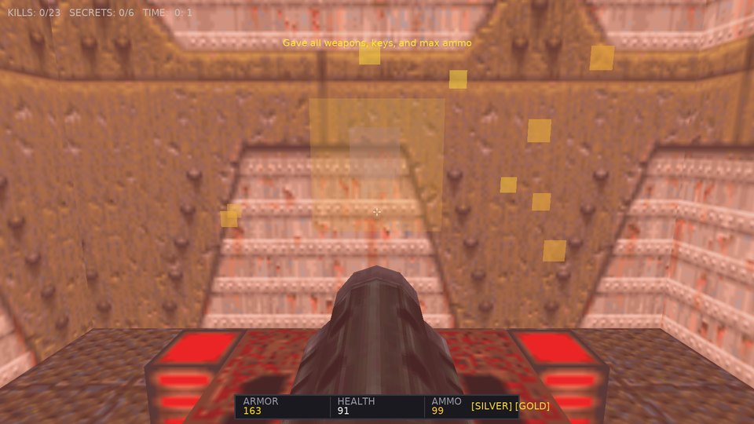
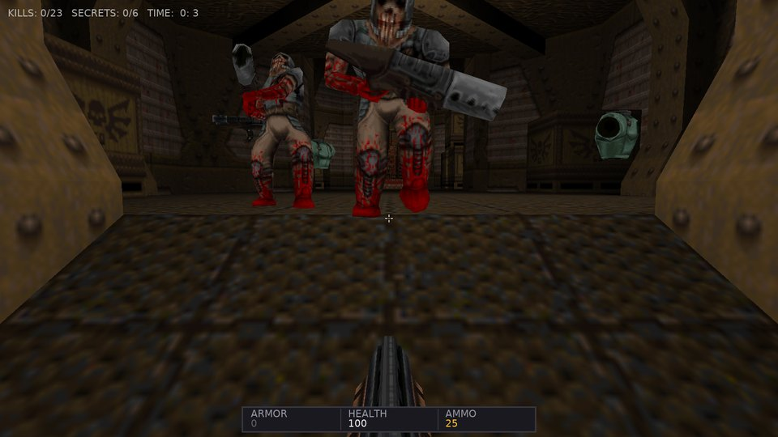
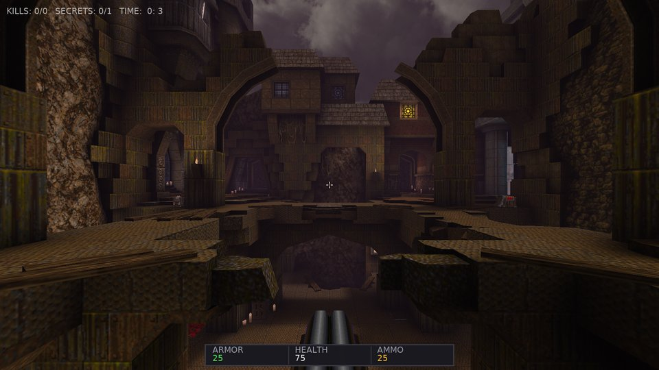
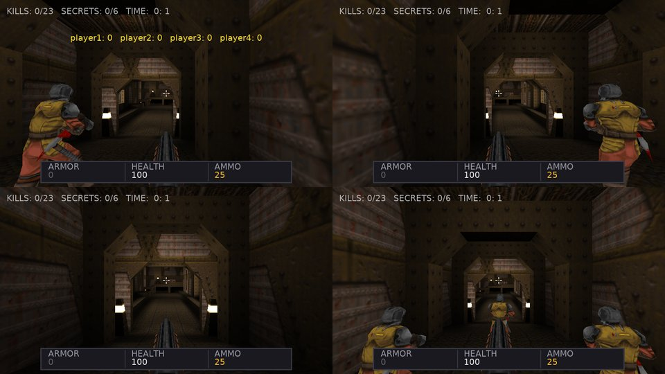
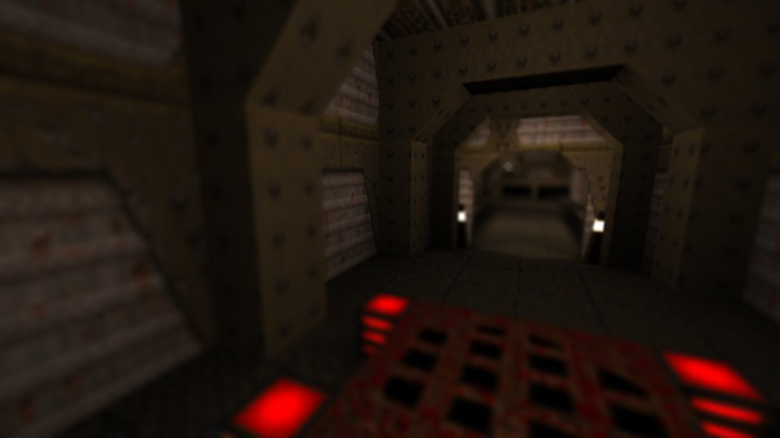

# Castle Quake

A port of **Quake 1** to the [Castle Game Engine](https://castle-engine.io/), written in Object Pascal (Free Pascal). It plays the bundled open-source **LibreQuake** levels and the original **Quake 1 shareware** data, and runs community maps and mods such as Arcane Dimensions.



- 🌐 **[Play in the browser](https://mariuz.github.io/castle-quake1/)** (WebAssembly)
- 📦 **[Download a release](https://github.com/mariuz/castle-quake1/releases)** for Windows, Linux, macOS or Android

## What it does

- **The whole game**: all eight weapons, all monsters and both bosses, Quake's player physics, the hub, keys, secrets, intermissions and endings.
- **Quake's look**: BSP levels with lightmaps and lightstyles, the scrolling sky, rippling liquids, animated models, particles; or dynamic PBR lighting with shadows instead.
- **Multiplayer**: deathmatch, coop and teamplay over UDP or from the browser, split-screen for up to four players, bots, spectators, LAN search, chat and a scoreboard.
- **Community content**: a map browser for 1750 [Quaddicted](https://www.quaddicted.com/) maps and mods, BSP2 maps, colored light, fog, skyboxes, texture packs, and the mod's own QuakeC (`progs.dat`) with the QuakeSpasm, FTE and DarkPlaces extensions.
- **New ways to play**: random maps from a seed, horde mode, speedruns against your ghost, map records, photo mode.
- **Comfort**: gamepads with their own button names, touch controls, six languages, captions for sounds, a high contrast HUD, rebindable keys, savegames with thumbnails.
- **For developers**: demos record and play back, every object is named in the engine's inspector (F8), levels export to X3D / glTF, and a headless test harness plays the game by script.

The full list is in [docs/FEATURES.md](docs/FEATURES.md).

| | |
| :---: | :---: |
|  |  |
| Monsters with Quake's AI | Arcane Dimensions with its own QuakeC |
|  |  |
| Split-screen coop for up to four players | Photo mode with depth of field |

More screenshots are in [docs/FEATURES.md](docs/FEATURES.md#screenshots).

## Quick start

Download a release and run it, or build it with [Castle Game Engine](https://castle-engine.io/) 7.0-alpha.3 or later:

```sh
castle-engine compile --mode=release
./castle-quake1                        # the menu
./castle-quake1 -warp e1m1             # straight into E1M1
./castle-quake1 -game quake            # the original shareware content
./castle-quake1 -host e1m1 -bots 3     # deathmatch against three bots
./castle-quake1 -randommap             # a new random level
```

**Controls**: WASD and the mouse, Space jumps, E uses, 1 to 8 pick weapons, F6 / F9 quicksave and quickload, P is photo mode, `~` opens the console, Escape the menu. Gamepads and touch screens work too.

Every option, the console commands, all the controls and the build steps for each platform are in [docs/USAGE.md](docs/USAGE.md).

## Documentation

| | |
| --- | --- |
| [docs/FEATURES.md](docs/FEATURES.md) | Everything the game does, with screenshots |
| [docs/USAGE.md](docs/USAGE.md) | Command line, console, controls, building |
| [docs/ARCHITECTURE.md](docs/ARCHITECTURE.md) | How the code is organized and how Quake maps to the engine |
| [docs/ROADMAP.md](docs/ROADMAP.md) | What is done and what is planned |
| [docs/HISTORY.md](docs/HISTORY.md) | How each finished roadmap item was built and tested |
| [docs/REFERENCE.md](docs/REFERENCE.md) | Developer reference: the test harness, log lines, test suites |
| [AGENTS.md](AGENTS.md) | Working notes for contributors and AI agents |

## License

- Code: MIT License (matching Castle Game Engine and mariuz/castle-doom).
- LibreQuake assets: see `data/paks/COPYING.txt` and `CREDITS.txt` (GPL / BSD / CC).
- Quake is a registered trademark of id Software / ZeniMax Media.
