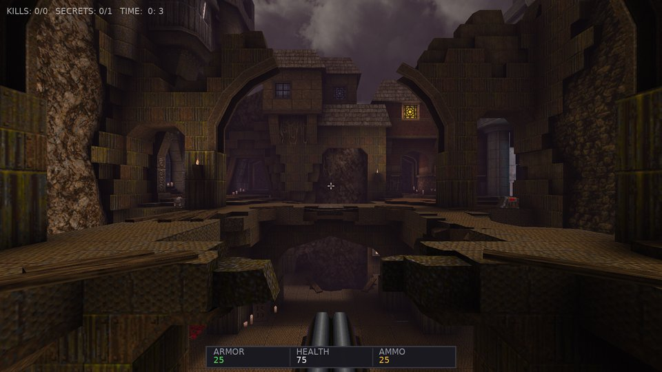
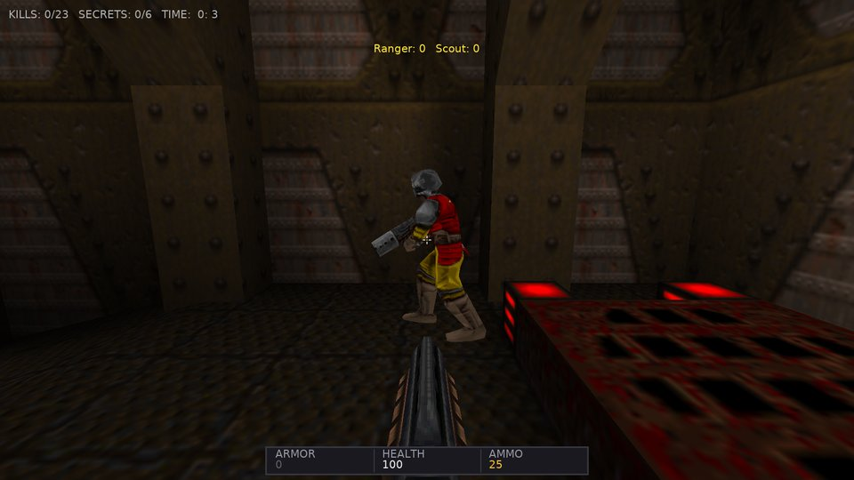

# Castle Quake: Architecture & Technical Design

This document explains the technical architecture of **Castle Quake**, how Quake 1 game data is parsed and rendered in the **Castle Game Engine (CGE)**, and which engine features each subsystem utilizes.

---

## 1. Overview & Data Flow

```
┌────────────────────────┐
│  pak0.pak / pak1.pak   │
│ (LibreQuake / Quake 1) │
└───────────┬────────────┘
            │
            ▼
        QuakePak (TQuakePak)
        ┌───┴──────────────────────────────┐
        ▼                                  ▼
   QuakePalette                       QuakeBsp (v29)
(palette.lmp, colormap.lmp)       (lumps, planes, faces,
        │                          texinfo, models, ents)
        ▼                                  │
quaketex: URL protocol                     ▼
(CGE Texture Cache)                QuakeGeometry
        │                      (X3D Node Scene Graph)
        │                                  │
        └──────────────┬───────────────────┘
                       ▼
                 QuakeWorld (Simulation)
            ┌──────────┴──────────┐
            ▼                     ▼
      QuakeEntities          QuakeLight
   (Pickups, Monsters,   (TCastlePointLight,
     Projectiles)         Lightstyles, Shadows)
            │                     │
            └──────────┬──────────┘
                       ▼
                 GameViewPlay (TCastleView)
                 ├── TCastleViewport
                 ├── TCastleWalkNavigation
                 ├── QuakeHud (Status Bar)
                 ├── QuakeParticles
                 └── QuakeConsole & QuakeMenu
```

Three core design principles drive Castle Quake:

1. **Native Engine Representation**: Geometry is represented as standard X3D nodes (`TShapeNode`, `TIndexedTriangleSetNode`, `TCoordinateNode`, `TAppearanceNode`, `TMaterialNode`) loaded into `TCastleScene`. Submodels (`func_door`, `func_plat`, `func_button`) are dynamic `TCastleTransform` nodes.
2. **Custom URL Protocols**: PAK files and textures are served through CGE's URL system (`quakepak:`, `quaketex:`). Textures are decoded into 32-bit TGA streams in memory, allowing CGE's GPU texture cache and mipmapping to work transparently without disk writes.
3. **Showcasing CGE Features**: Dynamic point lights with animated lightstyles, real-time shadow maps, positional 3D sound sources (`TCastleSoundSource`), particle effects, customizable camera navigation, and an automated headless test harness.

---

## 2. Coordinate System & Units

Quake uses:
- X = East (+X right)
- Y = North (+Y forward)
- Z = Height (+Z up)

Castle Game Engine uses Y-up:
- CGE.X =  Quake.X
- CGE.Y =  Quake.Z  (Height)
- CGE.Z = -Quake.Y  (Forward is -Z)

This transformation has a determinant of +1, preserving triangle winding order, surface normals, and handedness. 1 Quake unit equals 1 CGE unit.

Player dimensions:
- Quake eye height: 40 units -> `TCastleWalkNavigation.PreferredHeight = 40.0`
- Maximum step height: 18 units -> `TCastleWalkNavigation.ClimbHeight = 18.0`
- Run speed: 320 units/s -> `TCastleWalkNavigation.MoveSpeed = 320.0`
- Jump velocity: 270 units/s -> `TCastleWalkNavigation.JumpSpeed = 270.0`

---

## 3. QuakePak: Archive Management

- Supports stacking multiple PAK archives (`pak0.pak`, `pak1.pak`, PWAD/custom paks). Files replaced by a later pak are kept: with `PreferOriginal` (the Quake episode hub, `-game quake`) every file (maps, models, sounds, item boxes) comes from the original id paks (`id1`, shareware) first and LibreQuake only fills in what they lack, so id1 maps play with id1's monsters and sounds (with LibreQuake's models the hub's crucified zombies sat inside the walls). An original copy is cached apart from the replacing one: `VariantPath` puts `@original/` in front of the cache key and the `quakepak:` URL of sounds and box models (stripped by `NormalizePath`), models get the `_original` suffix, so switching hubs in one session does not reuse the other version; a `.lit` from a replacing pak is not applied to an original map. The `quake_hub` scenario checks the hub's zombies and their model. Samples are cleaned when the `quakepak:` handler serves them (`CleanWav`): many original Quake WAV files end with a broken chunk (a LIST of a few bytes declaring gigabytes) or a data chunk longer than the file, which Quake's loader ignores but the engine's WAV reader fails on; on WebAssembly that exception cannot be caught and froze the game (the first item pickup in the Quake hub). The sample is rebuilt with only its `fmt ` and `data` chunks, clamped to the bytes present; `TestSoundFiles` loads every shareware sample, and the web smoke test plays `?game=quake` (the page parameter for the original content).
- Game directories (`-game <dir>`, `GameInitialize.LoadGameDir`): a mission pack (`hipnotic`, `rogue`) or mod directory found in the working directory, next to the executable, in the data or the config directory (or a path), loaded after id1 so its files win: first its loose files (`TQuakePak.AddDirectory`, recursive, `pekFile` entries read from disk), then `<dir>/pak0..pak9.pak` (which override loose files, like Quake), then its `*.pk3` zip archives in name order (`AddPk3`: the central directory, stored and deflated entries, inflated with paszlib's `TDecompressionStream`); a directory reached from two bases is loaded once. Archives on disk stay there: `AddFile` and `AddPk3` open a local file as a `TFileStream` (`OpenArchive`) and read an entry when it is asked for (`ReadAt` seeks to the container's `Base` plus the entry's offset), only a URL that is no file (the web, Android's assets, http) is copied into a `TMemoryStream`; every archive is a `TQuakePakContainer` (stream, base, size, owner, original, mount tag). `GetData` keeps unpacked zip entries, loose files and entries of paks read from disk in a cache so callers get a pointer like for a pak in memory (callers copy what they need right away); `QuakePak.GameDir` names it. `-game quake` / `id1` only switch `PreferOriginalMaps`. QuakeC mode runs the pack's `progs.dat` this way; `TQuakeQcGame.PlayerItems` adds rogue's `items2` field in the high bits and `TViewQc` maps keys 9 / 0 to hipnotic's impulses 225 / 226.
- Map browser (`QuakeMapBrowser`): `TQuakeMapBrowser` (one lazily created, `MapBrowser`) reads the catalog (`-mapcatalog`, else `castle-config:/quaddicted_maps.txt` if present, else `castle-data:/quaddicted/maps.txt`), one tab separated line per release from `tools/quaddicted_catalog.py`. `Install` starts one `TCastleDownload` (memory stream; `CastleHttps` for https with FPC); `Update`, called every frame by the menu and the play view, finishes it: `Sha256Hex` against the catalog, then `UrlSaveStream` to `castle-config:/quaddicted_<id>.zip`. `Mount` calls `TQuakePak.AddPk3(Url, Mapping)`: each central directory name goes through `MapArchivePath` (the longest `from` prefix of the release's `from>to` pairs, `to` relative to the Quake directory; only what lands in `id1/` is indexed, as its path there), so the release's maps sit above the paks like a `-game` pk3 for the rest of the session. `Sorted` (shell sort, no generic comparer for the web compiler) and `Describe` feed the menu's `smBrowser` page (ten per page, `FBrowserActions` holds what each item does) and `smBrowserMap` (details, Play per start map, Remove), rebuilt when `BrowserState` (page, sort, installed, download progress) changes; a finished "Download and play" plays the first start map. Mods: a line's `gamedir`, `needs` and `paks` columns name the Quake directory a release plays in, the mod releases it needs and a mod's paks inside its zip. `Install` queues the missing needs before the map (`FQueue`, one download at a time); `Mount` mounts the needs first, then the zip with `MapArchivePath(..., GameDir)` (paths landing in `<gamedir>/` are indexed like `id1/` ones), then each nested pak with `Pak.AddPakFromArchive` (a stored one is a container sharing the zip's file stream at its data offset, a deflated one is unpacked once to `castle-config:/quaddicted_<id>_<pak>` and read from there, `Remove` deletes it), and sets `QuakePak.GameDir`. Everything a release adds carries `Pak.MountTag` (its id): `Mount` first unmounts (`UnmountAllBut`, the last mounted first) the releases that are not the map or one of the mods it needs, `TQuakePak.Unmount(Tag)` drops their entries, brings back the entries they shadowed (the highest container below) and frees their streams, and `QuakePak.GameDir` goes back to what it was before the first mount when no mod is left. `VariantTag` / `VariantPath` put the tag in the cache keys of models (`TQuakeMdlManager`), sounds, ambient sounds and brush models, so a file of one mod and the same path in id1 or another mod are never mixed up after a switch. `NeedsQuakeC` maps play through `TViewPlay.PlayInQuakeC` (the menu's `maPlayQc`, `maps_play`), which hands the rest of an autotest script to `ViewQc`. The web build lists but does not install.
- Intermission: `TQuakeWorld.StartIntermission` (camera at `info_intermission`, player frozen, monsters lose their target) and `TQuakeHud.StartIntermission`, which draws the qpics from `QuakePics` (`gfx/*.lmp` and `gfx.wad` lumps decoded with the palette into `TDrawableImage`s) on a 320x200 layout scaled to the window.
- QuakeC VM (`QuakeProgs`): `TQuakeProgs.Load` reads `progs.dat`; `Execute` interprets the bytecode (globals and entity fields are 4-byte cells, entity values are edict indexes, pointers are cell indexes into the edict memory); builtins are methods registered by number, the world dependent ones call `TQuakeProgsHost` (the default host is self contained). `SpawnEntities` and `RunFrame` mirror `ED_LoadFromFile` and the think part of `SV_Physics`. `QuakeQcGame.TQuakeQcGame` is the host for a real level: `TraceBox` (hull by size, pushers at their origins, solid entity boxes), `sv_move.c` ports for the monster builtins, `sv_phys.c` movetypes (`PhysicsPusher`, `PhysicsStep`, `PhysicsToss`, noclip), the player as edict 1 moved by `TQuakePlayerPhysics` around `PlayerPreThink` / `PlayerPostThink`, trigger touches and the svc messages written by the progs. `GameViewQc` renders its edicts and reads the player's fields for the HUD. It is a second gameplay path next to `TQuakeWorld`, used for mods.
- World lighting (`QuakeGeometry`, `QuakeLight`): the BSP lightmaps are packed per lightstyle slot into up to 4 atlases (`TQuakeLightmapAtlas`, `LightmapAtlasSize` 2048 for the world, 512 for brush entities); a full atlas opens another page (`TQuakeLightmapAtlasList`), batches are keyed by texture and page and each page has its own lightmap set, so big maps never fall back to fullbright faces (`-lmatlas <size>` shrinks the pages for testing); each face carries its lightmap coordinates and 4 lightstyle indexes as vertex attributes, and one `TEffectNode` per BSP model (`TQuakeLightmapSet`) blends the layers with the `quake_lightstyles` uniform (from `TQuakeLighting.GetStyleMultiplier`, sent when a value changes) and adds `quake_dlights` (`TQuakeLighting.AddDLight`, filled by `TriggerMuzzleFlash`) in `PLUG_main_texture_apply`. With `WorldLightmaps = False` the surfaces get a `TPhysicalMaterialNode` lit by the map's `TCastlePointLight`s instead. Colored light: a `maps/<name>.lit` (QLIT version 1) next to the map (`TQuakeBsp.LoadLit`, `LitData`) makes the atlas pages RGB (`TQuakeLightmapAtlas.Rgb`, `SetTexelRgb`) and the shader sums RGB light (`quake_lm_rgb`). Fog: the worldspawn `fog` key (`TQuakeGeometry.WorldFog`) becomes the viewport's `TCastleFog` (`ApplyWorldFog`, `SetViewportFog`): exponential, with `VisibilityRange = 64 * sqrt(ln 2) * (1 + 1 / ln 2) / density` so it reaches one half where FitzQuake's GL_EXP2 fog (density / 64) does.
- Key doors (`TQuakeSubmodel.KeyNeeded`, `TQuakeWorld.TouchKeyDoor`): `func_door` with spawnflags 8 / 16 has no trigger field and `wait -1`; running into it or using it with the key opens it and takes the key, otherwise the worldtype message and try sound play (2 s cooldown).
- Liquids (`QuakeGeometry`): faces with `*` textures are translucent, non-solid batches with an `Effect` whose `PLUG_texture_coord_shift` ripples the texture coordinates like `R_Turbulent` (turbsin: 8 of 64 texels, `liquid_time` with a 2 pi period sent from `Update`).
- Demos (`QuakeDemo`, `GameViewDemo`): `TQuakeDemoReader` plays `.dem` files like `cl_parse.c` / `cl_main.c` (blocks of length, view angles and server messages; entities interpolated between the two latest server frames, `CL_LerpPoint`), reporting sounds, temp entities, particles, prints and lightstyles through events. `TViewDemo` loads the demo's map into its own viewport, places the brush entities and alias models each frame, follows the view entity and draws the view weapon, beams and the status bar. Playback controls (file demos only): `MeasureDemoLength` plays the demo through once in a reader without events; `Update` advances the reader by the frame time times `FDemoSpeed` (0 while `FDemoPaused`) and the visuals, particles, lights and world animation by the same step, keeping `FPlayClock`; `SeekDemo` reads ahead in 0.05 s steps with `FSeeking` set (the sound, temp entity, particle, print, centerprint and damage handlers return at once), and for a goal behind the clock first `Load`s the demo again, so its serverinfo reloads the level and every message up to the goal is applied in order. `TQuakeDemoReader` also reads FitzQuake's protocol 666: the `U_EXTEND1` / `U_EXTEND2` entity bits (high bytes of model and frame, alpha, lerp finish), `SU_EXTEND1` / `SU_EXTEND2` client data (high bytes of the weapon, armor, ammo and weapon frame), `SND_LARGEENTITY` / `SND_LARGESOUND`, `svc_spawnbaseline2`, `svc_spawnstatic2`, `svc_spawnstaticsound2`, `svc_skybox` and `svc_fog` (kept in `SkyboxName`, `FogDensity`, `FogColor`); and RMQ's protocol 999, the same messages with protocol flags (a long after the protocol number in `svc_serverinfo`, `ProtocolFlags`) choosing the coordinate encoding (`PRFL_FLOATCOORD`, `PRFL_INT32COORD` in sixteenths, `PRFL_24BITCOORD` a short and a byte of 255ths, else 16-bit eighths) and the angle encoding (`PRFL_FLOATANGLE`, `PRFL_SHORTANGLE`, else a byte) in `ReadCoord` / `ReadAngle`. `TQuakeDemoWriter` records protocol 15 from `TQuakeWorld.RecordFrame`, using the 666 extension bits only for numbers above 255 and then marking that level's serverinfo as 666 (always with `-protocol 666`); the network server (`NetGameProtocol`) picks 666 for a level with more than 255 models or sounds (hooks on `Sounds.OnPlay`, `Particles.OnEffect`, `Hud.OnMessage`), one serverinfo section per level, baselines and model / sound lists written when the file is saved.
- Large coordinates (`QuakeBsp.MapNeedsLargeCoords`, `QuakeDemo`, `QuakeNet`, `QuakeServer`, `QuakeQcGame`): protocols 15 and 666 send coordinates as 16-bit eighths (-4096..4095.875), so a world model reaching beyond that makes the level protocol 999 with `RMQProtocolFlags` (`PRFL_SHORTANGLE or PRFL_FLOATCOORD`, QuakeSpasm's default). The demo writer decides per section at `BeginLevel` (`LargeCoords`, or `PreferredProtocol = ProtocolRMQ` from `-protocol 999`), because the frames are encoded as they are recorded; `FLarge` switches `WriteCoord` / `WriteAngle` and the delta comparisons (`SameCoord`, `SameAngle`) for that section, also while `SaveToUrl` writes its signon. The server sets `NetGameProtocol` to 999 in `BuildLists`, `TQuakeNetMessage` then writes floats and 16-bit angles (and the flags after the protocol in the serverinfo), and `TQuakeQcGame.LargeCoordMessages` makes the progs' `WriteCoord` / `WriteAngle` bytes, forwarded to the clients as they are, use the same encoding.
- Sky and fog over the wire (`QuakeDemo`, `QuakeNet`, `QuakeServer`, `GameViewDemo`): FitzQuake's `svc_skybox` (37, a name) and `svc_fog` (41, density and color as bytes of 255, a fade time in hundredths) are written only with protocol 666, which the server and the demo writer pick for a level whose worldspawn has a `sky` or `fog` key (`WorldspawnSky`, `WorldspawnFog`). The server sends them after the lightstyles of each client's signon; a demo section keeps the level's sky and fog for its signon (`SetLevelEnvironment`) and `WriteFog` / `WriteSkybox` record changes in a frame (the play view's console `fog` and `sky`). The reader sets `FogChanged` / `SkyboxChanged` (also for a stuffed `fog` command, `ParseStuffText`) and `TViewDemo.ApplyEnvironment` applies them after the map's own fog and sky: the fog to the viewport, the skybox through `TQuakeGeometry.SetSkybox`, which rebuilds the effect of every sky surface (kept in `FSkySurfaces`) with `CreateSkyEffect` and the uniform lists `Update` drives.
- Inspector names: every transform the game creates gets a `Name` from `ComponentName` (`QuakePak`: identifier-safe base plus a per-level running number), so the engine's inspector (F8, enabled in all builds from `GameInitialize`) and the demo action `I` (`LogSceneTree`) show `world`, `func_door_7`, `monster_ogre_3`, `pickup_shells_2`, `light_12`, `ambient_comp1_1`, `edict_N`, `entity_N`, `view_weapon`, `camera`; `TQuakeLighting.Clear` frees the level's lights.
- Gamepad prompts (`GameInput`): `PadFamilyOfName` turns `TGameController.Name` into a `TPadFamily` and `GamepadFamily` applies the `GamepadLayout` option; `PadButtonLabel` has one name table per family indexed by `TGameControllerButton` (positions: `gbSouth` is A, Cross or B). `GamepadConfirmButton` / `GamepadBackButton` (from `GamepadConfirm`, Auto meaning east on Nintendo pads) replace the fixed south / east in `TQuakeMenu.Update` and the photo mode; the menu, its Controls hint, the map browser, the photo help line and `TQuakeHud`'s intermission line build their text from the labels. The play view opens the menu on `gbMenu`; the menu raises `maCloseMenu` on `gbMenu` or back on the main page (it reads the pad in its own `Update`, so the view does not see those presses). `SetVirtualPadName` names the explicit backend's virtual controller (`InternalBackend.Name`) for the `PN:` action.
- Save and Load Game menus (`QuakeSaveGame`, `QuakeMenu`): `ListSaveGames` finds `save_*.sav` in `castle-config:/` (`FindFilesList`) and reads each with `ReadSaveGameInfo` (map, `saved` date, skill, the `stats.` health, kills and level time), sorted by date, the newest first. `TQuakeMenu.BuildSlotItems` fills `smLoad` (one item per savegame) and `smSave` (slots 1..8) with an action list (`load:<slot>`, `save:<slot>`, `back`); `UpdateThumbnail` loads `save_<slot>.png` into the design's `SaveThumbnail` image when the selection changes (a save forces a reload). The menu raises `maSaveGame` / `maLoadGame`: the play view saves (and writes the thumbnail with `RenderViewportImage`) or loads, `TViewMenu` sets `ViewPlay.LoadSlot` and switches to the play view, whose `Start` loads the slot instead of a map. `FHeldFromMenu` is set while the menu or the console is open and cleared once neither jump nor fire is held, so the key or button that picked an item does not act in the game.
- Photo mode (`GamePhoto`): `TPhotoMode` belongs to a view (the play view and `TViewDemo`) and its viewport and navigation. `Enter` keeps the camera and the navigation's settings, turns the navigation's collisions and movement off (mouse look only), pauses `Viewport.Items` and shows the help design; the views stop updating the world (`TViewPlay.Update` returns after the photo branch, so `TQuakeWorld.Update` and the player physics do not run; `TViewDemo.Update` does not advance the demo) and hide the HUD and the weapon. `Update` flies the camera from the bindings and the gamepad; `ApplyView`, called right after `ApplyVideoSettings` and before a photo, sets the photo's field of view and the depth of field's projection planes. The effects are `TScreenEffectNode`s made once and enabled one at a time (depth of field with `NeedsDepth`, linearizing the depth with the near and far planes, an infinite far handled); ambient occlusion is `Viewport.ScreenSpaceAmbientOcclusion`. `TakePhoto` renders the viewport alone into a `TGLRenderToTexture` of Scale x the window (capped by `GLFeatures.MaxTextureSize` and 8192) through `Container.RenderControl`, the viewport temporarily not `FullSize` and sized to the photo, reads it with `SaveScreen_NoFlush` and saves a PNG. `Leave` restores the camera, the navigation and the HUD.
- Map export (`TQuakeGeometry.ExportMap`, `--export-map <map> <file.x3d|file.gltf>`): the world and the brush models built again as named `Transform`s, the light entities as `PointLight`s, textures saved as PNG files next to the output (`TTextureExporter` rewrites the `quaketex:` URLs), physical materials instead of the lightmap shader, saved with `SaveNode`.
- UI designs (`data/ui/*.castle-user-interface`): the menu, the HUD and the console are editor designs loaded with `UserInterfaceLoad` and filled by name (`ItemsGroup`, `MessageLabel`, `StatsLabel`, `ArmorValue`, `HealthValue`, `AmmoValue`, `KeysLabel`, `AirBar`, `Panel`, `OutputLabel`, `PromptLabel`); the code sets captions, colors and `Exists` each frame, the layout, fonts and colors are edited in the CGE editor. The palette blends, the crosshair and the intermission pictures stay in `TQuakeHud.Render`.
- Entities as behaviors (`QuakeBehaviors`): `TQuakeMonsterBehavior`, `TQuakePickupBehavior`, `TQuakeSubmodelBehavior` and `TQuakeTriggerBehavior` are `TCastleBehavior`s owned by and attached to the entity's transform (triggers get an empty transform under the `triggers` node) with published properties that read and write the entity's state, so the inspector (F8) edits a monster's health, a door's state or a trigger's wait while playing; `TQuakeWorld.LoadMap` attaches them after spawning.
- Debug overlay (`QuakeDebug`): `TQuakeDebugOverlay` keeps one unlit `TLineSetNode` with per-vertex colors under the `debug_overlay` transform; `TQuakeWorld.UpdateDebugOverlay` clears and refills it every frame according to `DebugModes` (trigger volumes, monster boxes and sight lines, mover bounds, the player's BSP leaf, player box and projectile markers). The console `debug` and `fps` commands and the demo action `D:` drive it; the QuakeC view's `E` action logs the edicts in use.
- QuakeC mode savegames and demos: `TQuakeProgs.SaveState` / `LoadState` write the VM (crc, entity field count, globals, used edicts with free flags and times, engine strings, precaches) as a stream; `TQuakeQcGame.SaveGame` / `LoadGame` store it hex encoded in a `TQuakeSaveData` with the map, skill, time, statics, lightstyles and view angles, reload the progs and the map without spawning (`LoadProgsAndMap`) and bind client 1's physics to the restored edict. `TViewQc` records demos with `TQuakeDemoWriter` from the player's fields and the visible edicts each frame, and from the game events.
- Multiplayer (`QuakeNet`, `QuakeServer`): `TQuakeServer` owns a `TQuakeQcGame` with `MaxClients` player edicts and `Deathmatch = 1` (or `Coop = 1` with a skill, for cooperative play) and a `TQuakeNetServer` (UDP, packets `[kind][seq][payload]`: connect / accept / refuse, reliable chunks acked one at a time, unreliable frames with a sequence number so late ones are dropped, inputs, disconnect, 10 s timeouts). On connect it takes a free client edict (`ConnectClient`: `ClientConnect` + `PutClientInServer`) and writes the signon into a `TQuakeNetMessage` (serverinfo with protocol 15, the map as model 1 followed by the progs' precache list so a progs `modelindex` is one more on the wire, lightstyles, `spawnstatic`, stats, setview, names and frags, setangle, signon 1-3). Each `Update` feeds the clients' latest `TNetInput` (angles, move, buttons, impulse; an input packet is used once so impulses do not repeat) into `SetClientInput`, runs one game frame (`MoveClient` per player, then `SV_Physics` for the rest) and sends every ready client `svc_time`, its `svc_clientdata`, the entities in its PVS and the frame's events. Like `SV_CreateBaseline`, `CreateBaselines` keeps every entity's state at the level start and the signon sends them (`svc_spawnbaseline`, `spawnbaseline2` in 666); like `SV_WriteEntitiesToClient`, `WriteEntities` sends only the entities whose box (`TQuakeQcGame.EntityBox`) touches a leaf of the fat PVS around the client's eye (`TQuakeBsp.FatPvs`: the rows of the leaves within 8 units, `BoxInPvs`), the client's own entity always, each with only the fields that differ from its baseline (`TQuakeNetMessage.Entity`); every 10 s the server logs entities sent, outside the PVS and dropped (a frame stops at 7000 bytes) and the bytes per frame; prints, centerprints, stuffcmds, lightstyles, frag changes and the non-effect svc messages of the progs go through the reliable channel. A level change reloads the game with the clients kept and resends the signon (`Resignon`). `TQuakeDemoReader.StartNetwork` makes the demo reader read the blocks pushed from `TQuakeNetClient` instead of a file (everything available each frame, `CL_LerpPoint` keeps the client time between the last two server frames), keeps the scoreboard and reports `svc_setangle`; `TViewDemo` with `NetHost` or `HostMap` set is the client view: it runs the listen server (`ListenServer`) when hosting, connects, reads the camera angles the mouse look turned, sends the input every frame and plays like a demo otherwise. `-host <map>`, `-connect host[:port]`, the Multiplayer menu, `--autotest host:<map>` / `connect:<host>`. Split-screen (`TViewDemo.SplitScreen`, `SplitPlayers`, `-splitscreen [stacked]`, `-splitplayers N`): the further players 2..4 are `TSplitPlayer`s (`FPlayers`, `FSplitCount` in use), each with a `TQuakeNetClient` and `TQuakeDemoReader` (only its centerprints, damage and intermission handled) joined to the listen server (`ConnectSplitPlayers`), and a `TSplitViewport` placed by `ApplySplitLayout` that shares `FViewport.Items` with its own camera, weapon holder and `TQuakeHud`; `JoinFromPads` adds a player when a pad of no player (`GameInput.PadPlayer`) presses Start. The entities are drawn once, from the first client, whose stream has every entity (`TQuakeServer.SplitScreen`), so `TQuakeGeometry.UpdateVisibilityAll` culls the world to the union of every camera's PVS (and `CullVisuals` the entities against it); each `TSplitViewport`'s `OnBeforeDraw` sets the sky shaders' eye to its camera (`SetSkyEye`); each viewport's `Hidden` list (its own player's body, the other weapon) is invisible during its `RenderFromViewEverything`. `UpdateSplitPlayer` turns a player's camera with its pad, sends its input (`SendSplitInput`, no prediction: the server is local) and places the camera at its view entity. Loopback sockets (`TQuakeNetSocket.CreateLoopback`, `NetLoopback`, always in the web build): a list of in-process endpoints by port, each with a queue of (sender port, packet); `Send` to 127.0.0.1:port enqueues into that endpoint, `Receive` dequeues and reports the sender as 127.0.0.1:port, so `TQuakeNetServer` and `TQuakeNetClient` run unchanged (the client's `OpenSocket` picks a loopback socket when a loopback listen server has the port). Coop bots (`QuakeBots`): with `TQuakeQcGame.Coop` set, `UpdateBot` picks its enemy among the live monsters (`EntityIsLiveMonster`) and `ChooseGoal` sets `Leader` to `NearestHuman` (a client that is not one of `FBots`): farther than `FollowDistance` it paths to him (`Repath` 1.5 s), else it takes the items near him or waits; `FarTime` beyond `CatchUpDistance` for `CatchUpTime` calls `CatchUp`, which picks a navigation node near the leader that his eye does not see and moves the bot there with `TeleportEntity` (`SetOrigin`, so its physics follow). Deathmatch rules: the progs read `fraglimit` / `timelimit` through `TQuakeQcGame.Cvar` and run their `CheckRules` / `NextLevel`; `TQuakeServer.ChangeLevel` replaces the progs' next map by the one after the current in `FRotation` when a rotation is set. Scoreboard: `TViewDemo` stamps each input's send time (`FInputSent`, by sequence) and takes the round trip when `TQuakeNetClient.AckedInput` moves (`FPing`, smoothed); `ScoreboardText` sorts `TQuakeDemoReader.Names` / `Frags` and `TQuakeHud.ShowScoreboard` sets the design's `ScoreboardLabel`, whose presence makes `RenderIntermission` leave out the tallies. Chat: `pkChat` carries a line from a client; `TQuakeNetServer.Update` hands it to `OnChat` and `TQuakeServer.HandleChat` puts `svc_print` `<name>: <text>` in every client's reliable message. `TViewDemo` edits the line in `Press` while `FChatting` (the HUD's message shows it) and `HandlePrint` shows the server's prints in the HUD. Network recording: the reader's network loop clears `FSignonBlocks` when a block held `svc_serverinfo` and keeps the blocks until `Signon = Signons`; `OnNetBlock` hands each parsed block to `TViewDemo.HandleNetBlock`, which appends it to `FRecord` as a demo block (length, `ViewAngles`, data) after the header and the kept signon. Names and colors: the connect payload is the spectator byte, the colors byte and the name (`TNetServerClient.Name` / `Colors`, `ClientRequestedName`, `ClientColors`); `TQuakeServer.HandleConnect` cleans the name (`SanitizedPlayerName`) and passes both to `TQuakeQcGame.ConnectClient` (kept in `FClients[E].Colors`, `team` = pants + 1), sends `svc_updatecolors` to everyone (and in `HandleSignon`), and `EntityState` gives a player edict its `colormap` (`U_COLORMAP` in `TQuakeNetMessage.Entity`, the baselines' colormap byte). `TQuakeDemoReader.Colors` keeps them per client; `TViewDemo.ShowVisual` looks up an entity's colormap there and recreates its visual with `TQuakeMdl.CreateScene(Skin, Colors)` when they change: `ColoredSkinId` translates the skin's kept palette indices (`FSkinPixels`) with `TranslatePlayerColor` and caches the image per colors. Teamplay: `TQuakeQcGame.Cvar('teamplay')` returns `TeamPlay` (`ServerTeamPlay`), `HandleSignon` stuffs `teamplay N` (read by `TQuakeDemoReader.ParseStuffText`), and `TQuakeServer.BalanceTeams` (after `AddBots`, a connect and a disconnect) applies `TQuakeBots.BalanceTeams` (each bot to the smallest of the humans' teams, padded with red and blue, `SetClientColors`) and sends `svc_updatecolors` for the bots it moved; `UpdateBot` skips clients of its `ClientTeam`. `TViewDemo.ScoreboardText` / `ScoreboardLog` group `SortedPlayers` by pants (`SortedTeams`, `TeamColorNames`). Spectators: `TNetServerClient.Spectator` comes from the connect packet's payload byte; such a client's `Edict` is the player it follows (`SetClientEdict`), `TQuakeServer.Update` reads its inputs only for fire edges (`FSpectatorButtons`, `NextPlayer`, `SpectatorFollow` sending `svc_setview`) and `SendFrames` writes it the followed player's client data and every entity (`SeeAll`). `TViewDemo` with `Spectate` sends the connect byte, predicts nothing, and on its own jump edge toggles `FSpecFree`: the eye is then `FFlyEye`, moved by the input's move along the view angles, the view entity's model is drawn and the weapon hidden. LAN discovery: `pkInfoQuery` / `pkInfo` are connectionless, so `TQuakeNetServer.Update` answers a query from any address through `OnInfo` (tab separated map, title, players, maximum, mode); `TQuakeLanDiscovery` owns one socket on a free port with `SO_BROADCAST`, sends the query to 255.255.255.255 and 127.0.0.1 on `DefaultNetPort` + 0..3 (`LanQueryPorts`) every `LanQueryInterval` for `LanSearchTime`, and merges answers from one server reached both ways (the same port, map, mode and title); with a loopback socket it queries `LoopbackListening` ports only. The menu's `smLan` page rebuilds when the count or the searching state changes (`LanState`), as the map browser's pages do. `GameInput.PlayerController(Player)` decides the pads: 0 the first one (one player), 1 (the keyboard player) the first only when there is one more pad than gamepad players, 2..`SplitPlayerCount` the next pads in order.
- Bots (`QuakeBots`): `TQuakeServer.AddBots` gives `TQuakeBots` free client edicts of the game (`ConnectClient`), kept apart from the network clients' slots, and `Update` runs `TQuakeBots.Update` before each game frame: every bot decides its input and moves through `TQuakeQcGame.RunClientInput` (the same `MoveClient` path as a network player's input). Navigation is built on the first update: a flood fill of hull 1 from the spawn points and items in 64 unit steps (`TraceHull` for each step up to 18 units and for the drop below, at most 240), spots in a `TDictionary` keyed by 32 x 32 x 24 cells, links to the neighbours reached; `FindPath` is Dijkstra with a binary heap. `ChooseGoal` scores the visible `item_*` / `weapon_*` edicts by worth / (200 + distance) for the bot's items and health, avoids a goal it failed to reach for 30 s and roams otherwise; `UpdateBot` follows the path, picks the nearest visible enemy (hull 0 trace), turns toward it at a skill-dependent rate with an aim error, strafes, fires, switches weapons by impulse, jumps or repaths when stuck and fires to respawn when dead. QuakeC needs the player's think after `PlayerPreThink` (`MoveClient` runs `RunThink` like `SV_Physics_Client`) for the death frames and the nailguns' refire.
- Browser players (`QuakeWebSocketRelay`, `QuakeWebSocketClient`): the relay listens on TCP (`-websocket <port>` on a host, default 26001, or `-wsrelay host[:port]` alone), answers the HTTP upgrade (`WebSocketAcceptKey`: SHA-1 and base64 of the key with the RFC 6455 GUID) and parses client frames (masked, 7 / 16 / 64-bit lengths, at most 64 KiB); each connection owns a `TQuakeNetSocket` towards the server, one binary message per datagram both ways, so the server sees an ordinary UDP client per browser. Plain HTTP gets a 400. In the web build (`WASI`) `TQuakeNetSocket.CreateWebSocket` wraps `TQuakeBrowserWebSocket`: a JS factory installed on `window` through Job.JS (`Function` constructor) creates the `WebSocket` with `binaryType = "arraybuffer"`, queues the messages and offers `quakePoll` / `quakeSend` / `quakeClose`, all inside try / catch; Pascal polls each frame and copies the `Uint8Array` with `CopyToMemory`. Job.JS objects are reference counted: one passed as `IJSObject` is never freed by hand. `Resolve` gives a zero stand-in address that `Receive` also reports, so the client protocol code is the same; the client turns a closed WebSocket into a disconnect with a message. `PageParameter('connect')` reads `?connect=` of the page at start.
- Browser storage (`QuakeWebStorage`): in the web build `castle-config:/` is the engine's memory file system, lost on reload. `RestoreWebStorage` (called in `ApplicationInitialize` before the bindings and options are read) copies every `localStorage` key `castle-quake:<path>` (base64) to `castle-config:/<path>` and remembers its content; `StartWebStorageSync` adds an `ApplicationProperties.OnUpdate` handler that once a second lists `castle-config:/` (`FindFiles`, recursive), skips files above `MaxStoredFileSize` (1 MB) and unchanged ones, and stores the rest. A JS helper object (made by the `Function` constructor through Job.JS, like the WebSocket factory) does `keys` / `get` / `set` with `atob` / `btoa` inside try / catch, returning an empty array or 0 on failure, and a refused write warns once. Native builds compile no-op stubs. `?warp=` and `?autotest=&demo=` page parameters drive the web build like the command line; its screenshots only log. `tests/websmoke.js` (Playwright) drives two visits in CI and `tests/websmoke_check.py` checks the canvas screenshots.
- Prediction and hole punching (`QuakeNet`, `GameViewDemo`): every `TNetInput` carries a sequence number and its duration in ms; the server queues a client's inputs and runs the player once per input for that duration (`TQuakeQcGame.RunClientInput`, after which `Frame` no longer moves that client), and each frame packet starts with the sequence of the last input applied. The client view keeps its own `TQuakePlayerPhysics` on the map (the brush entities where the server last showed them as colliders) and the unacknowledged inputs: a new server frame resets the physics to the view entity's origin, `svc_clientdata` velocity and ground flag, replays the pending inputs and the camera uses the predicted origin (not while dead or in the intermission; `Predict` / `-nopredict`). `TQuakeNetRendezvous` is a UDP service that remembers registered hosts by name (`pkRegister` every 5 s, 30 s expiry) and on a `pkLookup` sends the host's address to the client (`pkPeer`) and the client's to the host (`pkPunch`), which sends `pkHello` packets to it so its NAT lets the client's `pkConnect` in. `-rendezvous`, `-register name@host[:port]` on a host, `-connect name@host[:port]` on a client, `--autotest rendezvous`.
- Savegames: `QuakeSaveGame.TQuakeSaveData` (typed `key=value` text, saved through `castle-config:` URLs) filled by `TQuakeWorld.SaveGame`; `LoadGame` reloads the map with the saved skill and restores the player, submodels, pickups, monsters (`TQuakeMonster.RestoreState`) and triggers by index, then recreates the projectiles and gibs that were in flight (kind or model, origin, velocity, life, the monster owner by index).
- Episode and game endings (`TQuakeWorld`, `quakeworld_game.inc`): `IntermissionContinue` walks `intermission_running` 1 (tallies) to 2 (`EpisodeText` of e1m7 / e2m6 / e3m7 / e4m7, the shareware text when `maps/e2m1.bsp` is absent) to 3 (the all-four-runes text when `serverflags` has all episodes) before the next map; the HUD types the texts out over `gfx/finale.lmp` (`StartFinale`). `Telefrag` kills the monsters at a teleport destination; `monster_oldone` there starts `StartShubFinale` / `UpdateFinale` (teleport splash, death sound and lightstyle 0 `abcdefghijklmlkjihgfedcb`, the pop into gibs, the ending text, then `GameOver` which the play view turns into a new game). `misc_teleporttrain` is a spinning `progs/teleport.mdl` moving along its `path_corner`s at `speed` 100 and the fallback destination of a `trigger_teleport` that targets it.
- Game state across levels (`TQuakeWorld`): skill (`trigger_setskill`), server flags (episode runes), the level parms the player entered a map with (restored on death), and `SetChangeParms` on `trigger_changelevel`. The start map uses `info_player_start2` and the episode / boss gates once runes are collected.
- Case-insensitive lookup.
- Registered protocol `quakepak:` allows loading sounds and models via `quakepak:/sound/weapons/sgun1.wav`.

---

## 4. QuakePalette: Colors and Textures

- Quake palette `gfx/palette.lmp`: 256 RGB triples (768 bytes).
- Fullbright colors: indices 224 to 255 (unaffected by dimming). World textures carry this mask in their alpha channel (255 fullbright, 0 lit) for the lightmap shader; liquid textures (`*name`) are decoded opaque instead, because they have no lightmap and are blended by their alpha (`r_wateralpha`): with the mask every liquid was fully transparent and never seen (the `liquid_items` scenario checks the hub's `*blood1` wall ripples).
- `quaketex:` protocol serves uncompressed 32-bit TGA streams (`WriteTga`), avoiding slow PNG encoding in native and WebAssembly builds.
- Textures are cached in `TQuakePalette.FTextureCache` and referenced by `TImageTextureNode`.

---

## 5. QuakeBsp & QuakeGeometry: 3D Map Generation



- Reads Quake BSP version 29 lumps:
  - Faces, vertices, edges, surfedges, planes, texinfo, miptex, models, entities, nodes, leaves, marksurfaces, visibility, clipnodes, lightmaps.
- BSP2 and 2PSB (`TQuakeBsp.Format`): `LoadFromStream` reads the nodes, leaves, clipnodes, edges, faces and marksurfaces of each format's on-disk layout (`TBSP29Node`, `TBSP2PSBNode`, `TBSP2Node`...) into the same wide records (32-bit indexes, float node / leaf bounds), so the rest of the engine does not know the difference. BSP29 node and clipnode children are read as unsigned shorts like QuakeSpasm (maps with more than 32767 nodes). `tests/bsp2convert.py` rewrites a BSP29 map in both formats; the `bsp2` gameplay scenario loads E1M1 converted to each and compares it with the original.
- Triangles grouped by texture into `TQuakeGeomBatch`es.
- Interactive submodels (`func_door`, `func_plat`, `func_button`):
  - Model 0 is static world geometry.
  - Models 1..N are separate `TCastleScene`s attached to `TCastleTransform` with automated sliding, elevation, sound, and collision detection.
- Animated textures (`+0`..`+9`):
  - Cycled every 0.2s by updating `TImageTextureNode.SetUrl`.
- PVS culling (`TQuakeGeometry.BuildClusters`, `UpdateVisibility`):
  - The world model is split into clusters along the BSP tree: a subtree with at most `ClusterMaxFaces` (256) faces is one cluster, a bigger node keeps its own faces in a cluster and splits further. Each cluster has its own texture batches (one lightmap atlas for all), so a frame draws some hundred shapes instead of one per texture.
  - A cluster's leaves are the ones listing its faces in the marksurfaces lump; it is drawn when one of them is in the PVS of the camera's leaf (`TQuakeBsp.LeafPVS` decompresses the row once per leaf change), else its shapes get `Visible := False` (rendering only: collisions and raycasts still see them).
  - Maps are not vised through water, so with translucent liquids (`LiquidAlpha < 1`) the leaves on both sides of each liquid surface are linked (the leaf behind each liquid face, and the leaves listing the same face) and the PVS of the linked leaves of every visible leaf is added (one hop).
  - Entities (`CullScene`, `TQuakeWorld.CullEntities`, `CullVisuals` in the QuakeC and demo views): each frame the world bounding box of every monster, item, missile, gib and brush entity scene is pushed down the BSP tree (`BoxVisible`, like `SV_FindTouchedLeafs`) and the scene is drawn only when a touched leaf is in the PVS. It sets the child scene's `Visible` (pickups use their transform's `Visible` for collected items, and collisions ignore it); a hidden MDL scene is not rendered, so `TMdlAnimator` skips its pose updates (`WasVisible`). The player's weapon and the particles are not culled.
  - Everything is drawn from a solid leaf (outside the map), without vis data, or with `WorldPvsCulling = False` (console `novis 1`, demo action `N:0`). The views call `UpdateVisibility` with the camera position every frame (third person, free fly and the intermission camera included); it does work only when the leaf changes. Demo action `Z` logs the frame times between two `Z`s with the PVS counts.

---

- Skybox: `TQuakeGeometry.AddToWorld` reads the worldspawn `sky` key; when `gfx/env/<name>rt|bk|lf|ft|up|dn.tga` are in the paks (`SkyboxAvailable`) the sky batches get the `SkyboxFragmentShader` with six `sampler2D` uniforms (`quakepak:` URLs) instead of the two layer sky, picking the face from the view direction in Quake axes with the `vec_to_st` orientation of the original skybox code. Fullbright: `TQuakePalette.DecodeIndexed` with `FullbrightAlpha` writes alpha 255 for palette entries 224..255 (world textures only) and the lightmap shader mixes those texels to full color (`fragment_color.a`), the alpha mode staying opaque. Liquids: two sided, `DefaultLiquidAlpha` (0.65) as `1 - Transparency` of their unlit material, `LiquidAlpha` changes the live materials (console `wateralpha`). `TQuakeParticleManager.SpawnLavaSplash` is `R_LavaSplash` on every second cell of its 16 x 16 grid.

### Random maps (QuakeRandomMap)

- `maps/random<seed>.bsp` is in no pak: `TQuakePak.FindEntryIndex` calls `PakMissingFileHook` for a path it lacks, and `QuakeRandomMap`'s hook (installed in its initialization) builds the BSP29 and its `.lit` and adds them with `TQuakePak.AddMemoryFile`. Everything that loads a map by name (warp, changelevel, QuakeC, demos, the network client) gets the same file, and a seed gives the same bytes everywhere (an own xorshift generator, integer layout).
- Layout (`TRandomMapBuilder`): a grid of 36 x 36 columns (64 units) and 18 layers (16 units); each column is solid, a room or a corridor with a floor and ceiling layer. Rooms are placed apart, joined by two cell wide L corridors along Prim's spanning tree plus a loop or two, ranked by corridor depth from the start (room 0); the deepest is the exit room with a pad. Decorations: pillars, a dais one step up. A flood fill over the columns (steps of one layer, four layers of headroom) counts the reachable rooms.
- Compiling: `TKdGrid` (cells with a summed volume table) and `TKdTree` (split where the solid count changes between two slabs, nearest the middle; leaves are solid or empty boxes). Hull 0 is the tree over the cells (solid leaves share leaf 0); a face is each solid / empty cell boundary on the node that separates the two cells, merged per node, side and texture into rectangles of at most 256 units, then T-junction vertices are added from the corners of the other faces. `MakeClipGrid` grows the cells by a hull's box (the boundaries moved by the box, a cell solid when the box around its center overlaps solid), and the same tree over it gives hulls 1 and 2. Model 1 is the exit trigger (a box). No vis data: every leaf sees every leaf.
- Lighting: per luxel (16 units, the face clamped by a unit and lifted off the plane) the lights in reach in front of the face add `(light - distance) * (0.5 + 0.5 cos)` when a walk through the cells to the light finds no solid cell; up to four light styles per face (the exit pulses with style 2), colored per room into the `.lit`, the average into the BSP. Textures: the miptex lump of `start.bsp` (by name: walls, floors, ceilings, an exit texture), or generated bricks and tiles without one.

## 6. QuakeLight: Real-Time Dynamic Lighting

- Maps Quake `light` entities to real-time `TCastlePointLight` nodes.
- Quake lightstyles (0..12) emulated at 10 Hz:
  - `0: "m"` (steady)
  - `1: "mmnmmommommnonmmonqnmmo"` (flicker)
  - `10: "mmamammmmammamamaaamamm"` (fluorescent flicker)
- Dynamic muzzle flash: point light created at camera upon firing.
- Real-time shadows: `TCastlePointLight.CastShadows = true`.

---

## 7. QuakeMdl: 3D Alias Models



- Decodes Quake 1 Alias `.mdl` files (`IDPO`, version 6).
- Converts skins into CGE textures.
- Constructs `TCastleScene` meshes with `TIndexedTriangleSetNode`.
- `TMdlAnimator` plays QuakeC frame ranges at 10 Hz and interpolates vertices between keyframes on `TCoordinateNode`.

---

## 8. QuakeSound: Spatial Audio & Music

- Music: `PlayTrack(N)` maps Quake's CD track numbers to `data/music/trackNN.ogg` (track 2 when the file is missing); the native world, the QuakeC view and the demo / network client start the worldspawn `sounds` track of a map, and `svc_cdtrack` (`TQuakeDemoReader.OnCdTrack`, the raw message in `TViewQc.HandleMessage`) switches it. Under water (`SetUnderwater`) an EFX low-pass filter (`AL_FILTER_LOWPASS`, GAINHF 0.2) is set as the direct filter of every live OpenAL source; it is created once through CastleInternalEFX, applied again each frame while under water for new sources, and skipped without EFX or on the web.

- 2D sounds for UI and weapon fire (`SoundEngine.Play`).
- 3D spatial sounds with distance attenuation via `TCastleSoundSource` attached to doors, lifts, and monsters.
- Background OGG music played on `SoundEngine.LoopingChannel[0]`.
- `QuakeAmbient`: looping static emitters for ambient entities (Quake's linear `ATTN_STATIC` falloff computed in Pascal, OpenAL used for panning; at most 8 active sources) and BSP leaf ambients (water / wind) driven by the listener leaf's `ambient_level`.

---

### Captions and accessibility (QuakeCaptions)

- `TQuakeSounds.OnCaption` is called for every `Play` / `PlayAt`, before the check for a sound device, so captions work with the sound off and in every view. `QuakeCaptions` installs `Captions.HandleSound` there in its initialization; `SoundCaption` looks the path up in `CaptionTable` (a file, or a directory prefix like `sound/doors/`), and a positional sound gets a direction from the camera that `ApplyVideoSettings` passes each frame (`CaptionDirection`, CGE coordinates seen from above: forward -Z, right +X).
- `TQuakeHud.Update` ages the captions and shows them in the design's `CaptionsPanel` / `CaptionsLabel`; `ApplyContrast` recolors the status bar, titles, stats, message and captions when `HighContrastHud` changes. `DamageFlash` and `BonusFlash` scale by `FlashScale` and stop at `FlashLimit` (`ReducedFlashes`). `GameVideo` loads and saves the three options under `access/`.

## 9. QuakeWorld & Combat Simulation

- Layout: `code/quakeworld.pas` holds the `TQuakeWorld` declaration and includes its implementation from `code/world/quakeworld_*.inc`, one file per subsystem: `game` (construction, new game, respawn, intermission, `Update`), `map` (entity spawning, `LoadMap`), `player` (water rules, movement, damage, use, cheats), `weapons` (view model, traces, bullets, projectiles, explosions, gibs), `monsters` (`TWorldMonsterEnv`, steps, sight, noise, monster attacks), `movers` (submodels, targets, buttons, doors, lifts, triggers), `pickups`, `save`, `record` and `debug`. The pieces share the class's private state, so they are include files rather than units; the standalone helpers in them (`SaveStats`, `VelocityForDamage`, `ProjectileAttacker`, `SubmodelIsSolid`) have no world dependency.
- Weapons: Axe, Shotgun, Super Shotgun, Nailgun, Super Nailgun, Grenade Launcher, Rocket Launcher, Thunderbolt.
- Pickups: Armor, Health, Ammo, Keys, Powerups (Quad Damage, Pentagram). The health and ammo boxes are brush model files like Quake's (`maps/b_bh25.bsp`, `b_bh10` for rotten health with spawnflags 1, `b_bh100` for the megahealth with 2, `b_shell0/1`, `b_nail0/1`, `b_rock0/1`, `b_batt0/1` with spawnflags 1 for the large box): `CreateBspModelScene` (`QuakeGeometry`) loads the file, builds its model 0 with `BuildModelGeometry` once per path and gives every pickup a copy; a box does not spin or bob and its origin is a corner, so it touches the player with Quake's '0 0 0' '32 32 56'. The QuakeC and demo views draw the progs' `maps/b_*.bsp` entities the same way. A pickup logs `Picked up "<message>" (<model>)`.
- Monsters (`QuakeMonsters`): every Quake class is described by a `TMonsterDef` taken from QuakeC (size, health, gib threshold, frame ranges, run speed, attack frames, sounds). `TQuakeMonster.Update` runs a Quake-style think: sight checks with line of sight (`visible`), chasing with `SV_movestep` (hull traces, stair steps, no walking off ledges, detours when blocked; fliers and swimmers follow the player height), `CheckAttack` range chances, attacks fired on animation frames (hitscan pellets, ogre grenades, scrag / hell knight / vore / enforcer / zombie / lavaball missiles, shambler lightning), leaps (dog, fiend, spawn), pain, death and gibbing. The world implements `TQuakeMonsterEnv` (`TWorldMonsterEnv`) for traces, damage and missiles. Chthon wakes when used and only dies from the E1M7 electrodes (`event_lightning`); Shub-Niggurath is an invulnerable idle boss. Monsters fight an `Enemy` (nil = the player): damage from another monster class (`TakeDamage` with an attacker) starts infighting until that monster dies. Idle monsters wake on sight (`FindTarget`, with `infront` and `show_hostile`), on a monster that has just seen the player (`sight_entity`), and on gunfire noise (`TQuakeWorld.PropagateNoise`: within 1000 units, monster leaf in the player's PVS via `TQuakeBsp.LeafVisible`, no closed door in between); ambush monsters only wake on sight or damage.
- Entities with `SPAWNFLAG_NOT_MEDIUM` are skipped (skill 1), items fire their targets when picked up, and crucified zombies are decoration.
- Weapons follow QuakeC `weapons.qc`: hitscan and the lightning beam use `TraceShot` (BSP hull 0, brush entities, monster boxes); nails, grenades and rockets are `TQuakeProjectile`s moved by `UpdateProjectiles` with the same traces (grenades bounce with `ClipVelocity`). Explosions use `T_RadiusDamage` falloff, `CanDamage` line of sight and player knockback.
- Gibs: a monster killed below its `GibHealth` sets `GibPending`; `GibMonster` hides the body and spawns `TQuakeGib` heads and meat (`ThrowHead` / `ThrowGib`), moved by `UpdateGibs` as `MOVETYPE_BOUNCE`.

- Player physics: `QuakePhysics` ports the NetQuake server movement (`sv_user.c`, `sv_phys.c`) and the QuakeC player rules. The player is a 32×32×56 box traced through the BSP clipping hulls (`TQuakeBsp.TraceHull`, a port of `SV_RecursiveHullCheck`), brush entities at their current offsets, and monster boxes. `TQuakeWorld.MovePlayer` runs it each frame; the camera follows the eyes (origin + 22). `Move` splits a frame into equal steps between `MinPhysicsStep` (1/144 s) and 1/72 s, and frames shorter than the minimum add up until they reach it (a jump pressed in between is kept): Quake's traces stop 1/32 unit before what they hit, so a step whose gravity fall (800·dt²) is shorter than that misses the floor, and above about 160 steps a second the player lost the ground on most steps and, from about 800 fps, hovered stuck in the E1M1 ramp. The network client likewise sends an input only every `MinInputMsec` (7 ms) or more, so the server and the prediction run whole steps and stay in agreement; `TestPhysicsFrameRate` walks the ramp at 30 to 3000 fps. `TCastleWalkNavigation` is only used for mouse look, and for flying in free-fly mode.

---

### Horde mode

- `TQuakeWorld.HordeMode` (set by `TViewPlay` before `LoadMap`) makes `LoadMap` call `StartHorde` after `SpawnEntities`: the monsters are freed, the kill counts reset and the spawn spots collected (monster, `info_player_deathmatch` and item origins). `UpdateHorde` runs each frame after the monsters: the pause, the next wave (`HordeClass` picks the class by wave), the spawns (`HordeSpot`: hull free for the class, no monster within 80 units, out of the PVS or behind the player, nearest first; `SpawnHordeMonster` teleports it in with `Use`, so it hunts the player), the stuck monsters moved in again, and the cleared wave (bonus, pickups `Collected := False`, the dead removed unless a projectile is still theirs). Kills score in the monster loop (`HordeKill`); `CheckTriggers` skips `trigger_changelevel` and `CanSave` is False while a horde runs. The view shows `HordeText` in the HUD stats line and `ReportHorde` saves the best score per map on death.

### Speedrun timer and ghost

- `SetupGhost` (end of `LoadMap`) clears the recording and reads `castle-config:/ghost_<map>.ghost` (`QGST`, version, best time, count, `TGhostSample` records: time, origin, yaw) after an `UriExists` check (no exceptions on the web), and with `GhostRacing` builds the ghost: `progs/player.mdl` with its `TUnlitMaterialNode` made translucent and tinted, a `TMdlAnimator` for the run and stand frames. `UpdateGhost` records a sample every 0.1 s, places the ghost by binary search and interpolation at the level time (`UpdateGhostPose`) and checks the next 5 s checkpoint; `FinishRun` (from `StartIntermission`) logs the time and writes the run when it is the best. `SpeedrunText` goes to the HUD's stats line.

## 10. Input

- Bindings (`GameInput`): `Bindings[TQuakeBinding]` are local `TInputShortcut`s (group `igLocal`, names `quake_<action>`) created with their defaults by `InitializeBindings`, then `BindingList.LoadFromConfig(UserConfig, 'bindings')` (their own list, so the engine's global shortcuts do not report conflicts with them); `AssignBinding` rebinds one to a key, mouse button or wheel event with `AssignCurrent` and saves (`SaveToConfig` only writes what differs from the defaults). The views ask `BindingHeld` (keys, mouse buttons and the gamepad button standing for the action, the right trigger for fire) every frame and `BindingEvent` on presses; `TQuakeMenu` has the Controls submenu (`smControls`, `FBindWaiting` takes the next event). Gamepad tuning: `GamepadSensitivity` (multiplies both turn speeds), `GamepadDeadZone` (`ApplyDeadZone` zeroes the center and rescales the rest so the edge stays 1) and `GamepadInvertLook`, loaded with the bindings and written by `SaveGamepadSettings` (`gamepad/sensitivity`, `gamepad/dead_zone`, `gamepad/invert_look`, only when they differ from the defaults). Virtual pad: `SetVirtualSticks` / `SetVirtualRightTrigger` / `SetVirtualButton` switch `Controllers` to the engine's explicit backend (`TExplicitControllerManagerBackend`, one controller) and set its state; buttons go through the container's `UpdateGameControllers` like real ones, so the play view's demo actions `GL` / `GR` / `GT` / `GB` and the unit tests exercise the real code paths (a `GB` press is released 0.2 s after the engine reports it down). Gamepad: `Controllers.Initialize` at start, `GamepadMove` reads the left stick with a 0.2 dead zone into the user command, `GamepadTurnCamera` turns the camera with the right stick (160 deg/s yaw, 90 deg/s pitch, clamped at 85), `UpdateGamepad` / `GamepadJustPressed` give the edge of the buttons for use, weapon changes and the menus.
- Touch controls (`GameTouch`): `TQuakeTouchControls` loads `data/ui/touch.castle-user-interface` (made for a 900 pixel high window; `Resize` scales every element's size and translation by the height) and keeps one `TTouchPoint` per finger (role move, look or button; start and last position). `Publish` turns them into GameInput's `TouchMove` (the deflection from the landing point over the stick's radius, a 0.12 dead zone; the base moves under the landing point and the knob follows), `TouchButtons` (the controller buttons the on-screen ones stand for: `GamepadFire`, `GamepadJump`, `GamepadUse`, the D-pad, `gbMenu`) and, from `TouchMoved`, `TouchLookDelta` (screen heights); `GamepadMove` adds the stick to the left stick's, `GamepadTurnCamera` turns by `TouchLookDelta * TouchLookDegrees` once and clears it, `BindingHeld` and `UpdateGamepad` treat a touched button as pressed (`GamepadButtonFor` always sets its out parameter, since the compiler can evaluate both sides of the `and`). Native builds get the fingers from `Press` / `Motion` / `Release` (mouse button events with `FingerIndex`). The web build polls a JS helper each frame (`poll` returns `id,x,y;...` in canvas pixels from the bottom left) whose `pointerdown` / `pointermove` / `pointerup` / `pointercancel` listeners run in the capture phase on window and, while `setActive(1)`, stop touch pointers there (and set `touch-action: none` on the canvas) so the engine does not see them as clicks. `UpdateShown(Playing)` shows the controls when `TouchControlsWanted` (`TouchControlsMode` on, or auto with `ApplicationProperties.TouchDevice` or a touch seen) and the view is playing; `MenuRequested` reports the MENU button (the play view opens its menu, the QuakeC view goes to the menu view, the network view leaves). `TQuakeMenu.Press` runs a tapped item and goes back on a tap outside them.
- UI scale (`GameScreen`): `CastleSettings.xml` still names the 1600 x 900 reference for the editor, but at start `InstallUIScaleWatcher` puts an invisible control into the container (it stays across view changes) whose `Resize` runs `UpdateUIScale`: `ComputeUIScale(PixelsWidth, PixelsHeight, Density)` = max(enclosing scale, min(0.7 x density, width / 800, height / 480)) as `usExplicitScale`; changing the scale resizes the controls again, and the second time nothing changes. `ScreenDensity` is `ForcedDensity` (`-density`), else the page's `devicePixelRatio` (`PageDevicePixelRatio` in `QuakeWebSocketClient`, 0 natively), else `Container.Dpi / 160` on touch devices and `/ 96` on desktops. `TQuakeTouchControls.Resize` scales its design by min(unscaled height / 900, unscaled width / 800) within 0.55..1.4, so the overlay fits portrait screens; the JS touch helper asks for fullscreen and `screen.orientation.lock("landscape")` at the first touch (`setFullscreen`, `?fullscreen=0`).
- Localization (`GameTranslate`): `SetLanguage(Code)` ('' follows `SystemLanguage`; English when there is no `<code>.po`) reads `castle-data:/lang/<code>.po` through `UseTranslation` into a dictionary (`ParsePo`: msgid / msgstr with continued lines and escapes, the header and untranslated entries left out) and bumps `LanguageVersion`. `Tr(S)` looks a text up (S itself when absent); `TrItem` tries the whole menu item, then translates the label before ": " and the value after it (a bracketed value inside its brackets, recursively); `TranslateDesign(Root)` translates the labels and buttons the root owns line by line, keeping each one's English text and what it last showed (a label the code changed since starts over from its new text). The menu (`SyncDesign`), the HUD (`Update`) and the touch controls (`UpdateShown`) call it when `LanguageVersion` changed. The menu keeps its items in English (`FItems`, which `ExecuteSelection` compares) and shows `TrItem` of them; the map browser's items, dispatched by `FBrowserActions`, are translated when built. Captions log the English text and show `Tr` of it. `LanguageVolatile` (autotests, `-lang`) keeps the choice out of the user config (`ui/language`). The texts must be in the UI font's glyphs: `GameFontUi.Font_GameUi` (a texture font compiled in, DejaVu Sans at size 20 with the characters of `tools/font/ui_font_chars.txt`: Latin-1, Latin Extended-A, ș ț), loaded by `UseUiFont` first thing in `ApplicationInitialize` as `UIFont` and `Window.Container.DefaultFont`; `tools/font/make_ui_font.sh` regenerates it and `tools/lang_strings.py --check` flags a translation's character outside that list.
- Video options (`GameVideo`): `VideoFov`, `VideoGamma`, `ViewBob`, `ShowWeapon` (`video/fov`, `video/gamma`, `video/bob`, `video/show_weapon`, written only when they differ from the defaults; not loaded or saved in autotest runs, `VideoSettingsVolatile`). `ApplyVideoSettings`, called by the play, QuakeC and demo views every frame, sets the camera's vertical field of view (`VerticalFov` = 2 atan(tan(fov / 2) * 3 / 4), Hor+) and the gamma screen effect (a `TScreenEffectNode` owned through a `TGammaHolder` component of the viewport, `pow(color, gamma)`, disabled at 1). `CalcViewBob` is `V_CalcBob` (cl_bobcycle 0.6, cl_bobup 0.5, clamped to -7..4); the play view adds it to the eye after the shots and the contents checks (the physics puts the camera back next frame) and `TQuakeWorld.WeaponBob` moves the weapon forward by 0.4 of it; the QuakeC and demo views add it to the eye from the QuakeC player's and the recorded velocity.

## 11. Automated Headless Testing

- Gameplay scenarios (`tests/scenarios.py`): each scenario lists the processes to start (game arguments with `{out}` for the output directory, and a start delay so a client follows its host) and a check function over their logs; the log lines it parses are the play view's `View:` line, the multiplayer client's screenshot line (signon, health, ammo, frags) and prediction line, and the save / load lines of `TQuakeWorld`. Screenshots are scaled to 160x90; the 3D view (top 3/4) must have a mean brightness above 4 and the listed ones must be within a mean absolute RGB difference of 5 from `tests/reference/<scenario>_<shot>.png`. Random views (the intermission spot, deathmatch spawns, monsters in a fight) are only checked for not being black. The `budgets` scenario parses the play view's `Z` lines (`Frames: ... leaf, clusters, shapes, entities`) at fixed spots (`BUDGET_SPOTS`; the first `Z` of a spot starts counting and the second logs it) and compares the counts with `tests/budgets.json` within `budget_margin`; the leaf must match, so a budget is only compared at the same place. The measured counts and frame times go to `budgets.json` in the scenario's output and to `GITHUB_STEP_SUMMARY`.

- Unit tests (`tests/quaketests.lpr`): a console program with the Quake units on its search path (`tests/CastleEngineManifest.xml`), loading `quake1_demo.pak` from the directory given as its argument; `Check` / `CheckEquals` helpers count the failures and the exit code is 1 when any failed. Covered: `TQuakeBsp.PointContents` / `TraceHull`, `TQuakeProgs` (function lookups, `anglemod` through `Execute`, `SpawnEntities` counts, `RunFrame`, `SaveState` / `LoadState`), `TQuakeSaveData` and `TQuakeDemoWriter` / `TQuakeDemoReader`. The Build workflow's `test` job runs it on Linux before the packages are released.
- Community maps (`tests/community_maps.py`): reuses `scenarios.py` (`game_command`, `FRAMES_RE`, `budget_margin`); `spots` reads the entity and model lumps (the same layout in BSP29 and BSP2) and keeps the player start and the items farthest apart that are more than 256 units from any `trigger_*` brush model's box, as CGE eye positions. Each map gets one play run (`G:spot,W:0.5,Z,W:1,Z,NC` per spot) and one `qc:` run with `E`; the zips are unpacked into one `-game` directory (`maps/<name>.bsp`, `.lit`).
- Android package (`tools/android-fpc.sh`, the `build-android` job): the CGE build tool compiles the game as `libcastle_quake1_android.so` for each Android CPU with `fpc -Tandroid -Parm` / `-Paarch64` (ARMv7-A with VFPv3, 16 KB page alignment) and wraps it in its Gradle project (`data/` becomes the APK's assets, the paks included). The script's `fpc.cfg` includes the system one and adds, for Android, the cross units, `-FD<prefix>/bin` with `android-arm-` / `android-a64-` symlinks to the GNU `as` and `ld.bfd`, and the NDK sysroot's API 21 library directory (shared stubs only: the static `libc.a` one level up has versioned symbols GNU ld fails on, and `ld.lld` fails on FPC's `INSERT AFTER .data1`).

Command line parameters:
- `--autotest <MAP> <PREFIX>`: loads map headlessly, executes demo actions, takes screenshot, and terminates.
- `--demo "COMMANDS"`:
  - `W:sec` wait
  - `S` take screenshot
  - `X` fire weapon
  - `U` use/activate
  - `C:slot` change weapon
  - `F:sec` hold fire, `V:f;s;u` hold movement input, `J` jump, `G:x;y;z` teleport
  - `K` give all
  - `Y` god mode
  - `Q` quit

- Map records (`QuakeRecords`): `TMapRecords` holds a `TMapRecord` per map and skill (best time, kills, secrets with the totals, runs) and reads / writes `castle-config:/records.txt` as tab separated lines (`MapRecords` loads it once, `SaveMapRecords`). `Finish` returns a `TRecordNews` (first run, a new time, more kills, more secrets); `TQuakeWorld.StartIntermission` calls `FinishRecord`, which saves, logs and sets `TQuakeHud.IntermissionRecord` (drawn under the tallies once they are counted). `TQuakeMenu` puts `Describe(map)` of the selected Map Warp item in the hint line.

- QuakeSpasm compatibility: `QuakeSprite` (`TQuakeSprite`, `SpriteManager`) reads `.spr` version 1 into a scene whose `SpriteFrames` Switch holds a quad per image; `ApplyFrame` picks the frame (a group's image by its intervals) and `CreateBillboard` returns the `TCastleBillboard` of the sprite type, which the views add to the visual's transform (`TViewQc.ShowSprite`, `TViewDemo.ShowSprite`). Entity alpha: `TQuakeQcGame.EntityAlpha` → `TQuakeServer.EntityState` (`EncodeEntityAlpha`, protocol 666 when `UsesAlpha`) → `TQuakeNetMessage.Entity` / `SpawnBaseline` (`U_ALPHA`, `B_ALPHA`) → `TQuakeDemoReader` (`TDemoEntityState.Alpha`, the baseline when the bit is missing) → `ApplyAlpha` / `SetSceneOpacity` (appearances blended with the unlit material's transparency, back to the scene's own alpha mode when opaque). Fence textures: `TQuakeGeomBatch.IsFence` gives the appearance `amMask` and, with lightmaps, `CreateFenceEffect` before the lightmap effect (it discards alpha below 0.5 and sets the alpha to 0, the lightmap shader's "not fullbright"). Stuffed text: `TViewQc.HandleStuffCmd` and `TQuakeDemoReader.ParseStuffText` buffer it to a newline and split it at semicolons; `ParseFogCommand` is shared. Pose blending: `TQcVisual` / `TDemoVisual` keep `PrevFrame`, `LerpStart` and `LerpDone`, and `UpdatePose` calls `TQuakeMdl.ApplyLerp` until `ModelLerpTime` passed.

- Host console: `TViewDemo.SendChatLine` sends a chat line or, for a line starting with a slash, calls `RunHostCommand`, which runs `ListenServer.HostCommand(Line, FDemo.ViewEntity)` (the host's own player cannot be kicked) and shows the answer; the script's `CMD:` does the same for anything but the photo commands. `HostCommand` finds a player by name or edict number, removes a bot (`TQuakeBots.Remove`, `DisconnectClient`, empty name, frags and colors to everyone) or kicks a client (`KickClient` → `DropClient` with a `pkDisconnect`, whose `OnDisconnect` runs before the client is marked inactive so `HandleDisconnect` still finds its edict), changes the level with `ChangeLevel(Map, True)` (past the rotation), sets `FragLimit` / `TimeLimit` / `TeamPlay`, and prints the change with `PrintAll`.

- External textures: `TQuakeBsp.LoadExternalTexture` runs for each miptex but the sky while the BSP's textures are cached: it finds `textures/<map>/<name>` or `textures/<name>` (`.tga`, `.png`) through `Pak.FileExists`, loads it with CGE's `LoadImage` from `quakepak:/`, and rewrites its alpha for the lightmap shader (0 for a plain texture, the `_luma` / `_glow` image's brightness with its color added, the image's own alpha cut at half for a fence texture, 255 for a liquid) before it takes the miptex's place in the palette's texture cache under the same id, so the geometry, the animations and the brush models use it unchanged.
