# Castle Quake: Features

The full list of what the game does. For how to use it see [USAGE.md](USAGE.md); for how it is built, [ARCHITECTURE.md](ARCHITECTURE.md).

**World**
- BSP v29 levels, and the BSP2 / 2PSB formats of large community maps, from `.pak` files turned into X3D scene graphs, with triangle collision and the Quake clipping hulls for movement.
- Colored light from `.lit` files, fog from the worldspawn `fog` key and skyboxes from its `sky` key (FitzQuake / QuakeSpasm maps), also in demos and network games (`svc_fog`, `svc_skybox`).
- The scrolling two layer sky or a six face skybox (`sky` worldspawn key with `gfx/env/*.tga`), fullbright texture pixels, translucent liquids seen from both sides, lava splashes.
- Two world lighting modes: Quake's own lightmaps, all lightstyle layers blended in a GLSL effect with the live lightstyle values and dynamic lights (muzzle flashes, explosions), or dynamic PBR lighting by the map's light entities with real-time shadow maps.
- Dual-layer scrolling sky, turbulent liquid surfaces, animated textures, particles (gunshots, blood, explosions, trails, teleports), underwater warp and palette tints.
- Only the potentially visible set is drawn: the world is split by BSP subtrees and the parts outside the camera leaf's PVS are hidden (seen through translucent water too), and so are the monsters, items, missiles, gibs and doors outside it; console `novis 1` draws everything.
- Interactive brush entities: doors (including silver and gold key doors), platforms, buttons, trains, secret doors, triggers, teleporters, level changes.

**Gameplay**
- A port of the NetQuake player physics: friction and acceleration, air control, stair stepping, swimming, water jumps, bunny hopping.
- All eight weapons from `weapons.qc`: hitscan, nails, bouncing grenades, rockets with splash damage, the lightning beam.
- All thirteen monsters and both bosses with QuakeC data: sight checks, `SV_movestep` chasing, attacks on animation frames, pain, death, gibbing, infighting, sound propagation.
- Level flow: the hub with skill and episode portals, runes and episode gates, keys, secrets, level parms, intermission with counting tallies, the episode texts, the all-four-runes text and the Shub-Niggurath ending with the end-of-game text.
- Random maps: `-randommap [seed]` (or Single Player > Random Map, `?randommap=new` in the browser) builds a level in memory, rooms and corridors compiled into a real BSP with collision hulls, colored lightmaps, monsters getting harder toward the exit, weapons, ammo and health; the exit leads to the next seed, so the levels never end. The same seed is the same map everywhere, so a network game only needs its name (`-host random42`).
- Horde mode: `-horde` (or Single Player > Horde Mode) turns any map, a random one too, into waves of monsters that teleport in out of sight, stronger every wave, with a score and the best score per map.
- Photo mode: P pauses the game (or a demo), hides the HUD and flies the camera; change the field of view and add depth of field, grayscale, sepia, a vignette or ambient occlusion, then save a photo up to four times the window size.
- Speedrun timer and ghost racing: finish a level and your best run comes back as a translucent ghost to race, with splits at checkpoints and at the end (`-speedrun`, Options or the console's `speedrun` / `ghost`).
- Map browser: Main Menu > Map Browser lists 1750 community maps and mods from [Quaddicted](https://www.quaddicted.com/) with their ratings, downloads one (checked by SHA-256) and plays it; installed maps can be removed again. A map made for a mod (Quoth, Arcane Dimensions, Copper...) downloads the mod with it and plays with the mod's QuakeC. The zips stay on disk and are read as files are needed (a 300 MB mod does not take 300 MB of memory), and playing another map unmounts the mods it does not need. Also from the console: `maps`, `maps_install <id>`, `maps_play <id>`, `maps_remove <id>`.
- Languages: English, German, French, Spanish, Italian and Romanian for the menu, the HUD, the captions and the console help, following the system language or picked in Options > Language (`-lang de` for one run). A translation is a gettext `.po` file in `data/lang/`.
- Accessibility: captions for the sounds that matter (monsters waking and attacking, doors, lifts, secrets, pickups) with a hint of where they came from, a high contrast HUD and reduced damage and pickup flashes, in Options or the console (`captions`, `hud_contrast`, `reduced_flashes`).
- Save and load (F6 / F9, console `save` / `load`, Main Menu > Save Game / Load Game with eight slots and a thumbnail of each, `-load <slot>`), including projectiles and gibs in flight.
- LAN games: Multiplayer > Find LAN Games lists the games hosted on the local network (map, players, deathmatch or coop) and joins one with a press.
- Coop bots: `-host e1m1 -coop -bots 2` (or Multiplayer > Coop with 2 bots) adds bots that follow you through the level and fight its monsters.
- Deathmatch rules: `-fraglimit N`, `-timelimit M` and `-maps e1m1,e1m2,...` end a level at a limit and play the maps in turn.
- Scoreboard: Tab shows the players and bots by frags (and your ping) in a network game; a deathmatch intermission shows it too.
- Chat: in a network game T opens a line to say something to everyone.
- Recording network games: `-record <name>` with `-host` or `-connect` saves the game you play as a demo that plays back like any other.
- Names and colors: `-name Ranger -color 4 12` (or the console's `name` / `color`, Options > Shirt Color / Pants Color) — the others see your name on the scoreboard and your player in your shirt and pants colors.
- QuakeSpasm mods: Arcane Dimensions and other mods made for QuakeSpasm run with their own QuakeC (Map Browser > a map of the mod) — thousands of entities, fence textures, sprites, translucent entities, their fog, water alpha and music, smoothly animated models, monsters gliding between their steps (`r_lerpmove`) the FTE / DP QuakeC extensions they ask for (FRIK_FILE, FTE_STRINGS, `sprintf`, `tracebox`...) and DarkPlaces' `effectinfo.txt` particle effects (`pointparticles`, `trailparticles`, particle rain and snow, and the mod's own explosions, impacts and projectile trails) with the mod's particle texture. Brush entities can be water, slime or lava (FTE_ENT_SKIN_CONTENTS).
- Texture packs: `textures/<map>/<name>.tga` or `textures/<name>.tga` (or `.png`) in a mod directory replace a map's textures, with `_luma` / `_glow` glow maps, like QuakeSpasm-Spiked.
- Map records: every finished level keeps your best time, kills and secrets per skill — the intermission tells you when you beat them, Map Warp shows them.
- Host console: as the host of a network game, type `/status`, `/kick <name>`, `/map <name>`, `/fraglimit 10`, `/timelimit 5`, `/teamplay 1` or `/addbot` in the chat line (T).
- Teamplay: `-host e1m1 -teamplay 1 -bots 3` (or Multiplayer > Team Deathmatch with 3 bots) — teams by pants color, no friendly fire, bots even the teams and the scoreboard shows the team totals.
- Spectators: `-connect host -spectate` (or Multiplayer > Spectate) watches a network game without playing: fire follows the next player, jump flies freely.
- Demos: `.dem` playback with server frame interpolation (protocol 15, FitzQuake 666 and RMQ 999 for maps beyond 4096 units), and recording of your own games. While one plays, Space pauses, up / down change the speed (a quarter to four times) and left / right seek 10 s back or forward.

**QuakeC mode**
- `progs.dat` runs the level: a QuakeC VM (`pr_exec.c` semantics, all builtins) with a world host for traces, movetypes and the player physics. Mods loaded with `-pak` run unchanged. Savegames and demo recording work here too.

**Multiplayer**
- Deathmatch and coop over UDP: the host runs the QuakeC rules, NetQuake protocol 15 messages stream the game to every player, the client is the demo player with input. Host from the menu or with `-host`, join with `-connect`.
- Split-screen coop: `-host e1m1 -splitscreen` (or Multiplayer > Split-Screen Coop) plays a coop game with two players on one machine, side by side (`-splitscreen stacked`: one above the other): the keyboard and mouse for the first player, a gamepad for the second. Up to four players (`-splitplayers 4`, or a further gamepad's Start in a game). In the browser too: `?host=e1m1&splitscreen=1` (or `=4`), and bots with `?host=e1m1&bots=3`.
- Deathmatch bots: `-host e1m1 -bots 3` (or Multiplayer > Deathmatch vs 3 bots) adds bots that find their way around the map, collect weapons, health and powerups, and fight you and each other; `-skill` sets how well they aim.
- Browser players: a host started with `-websocket 26001` (or a separate `-wsrelay host:port`) relays WebSocket connections to the game, and the web build joins with `?connect=host` in its URL (an https page needs `wss://`, so a TLS proxy in front of the relay).
- Client-side prediction of your own movement (the server runs exactly the inputs you sent, the client replays the unacknowledged ones) and UDP hole punching through a rendezvous service: `-rendezvous` on a reachable machine, `-host e1m1 -register myname@rendezvous`, `-connect myname@rendezvous`.

**Engine integration**
- Custom URL protocols `quakepak:` and `quaketex:` feed the engine's loaders straight from the archives.
- Spatial audio with OpenAL, music per map from the CD track number (`svc_cdtrack` in demos and multiplayer), muffled under water with an EFX low-pass filter (Web Audio in the browser), static ambient emitters and leaf ambients, OGG music.
- Every component is named for the engine's inspector (F8): `func_door_7`, `monster_ogre_3`, `light_12`...
- Developer console (`~`): `map <name>`, `god`, `give all`, `shadows <0|1>`, `save`, `load`, `debug <all|off|triggers|monsters|movers|leaf>` (wireframe overlay of triggers, monsters and sight lines, movers and the player's BSP leaf), `wateralpha <0..1>`, `fog <density> [r g b]`, `sky <name>`, `fov`, `gamma`, `cl_bob`, `r_drawviewmodel`, `captions`, `hud_contrast`, `reduced_flashes`, `horde`, `killall`, `speedrun`, `ghost`, `ghost_reset`, `saves`, `maps`, `maps_install`, `maps_play`, `maps_remove`, `photo`, `photo_fov`, `photo_effect`, `photo_scale`, `photo_shot`, `fps`, `novis <0|1>`, `help`.
- A headless test harness (`--autotest`, `--demo`) drives the game by script and takes screenshots; the images above come from it.

## Screenshots

| | |
| :---: | :---: |
| 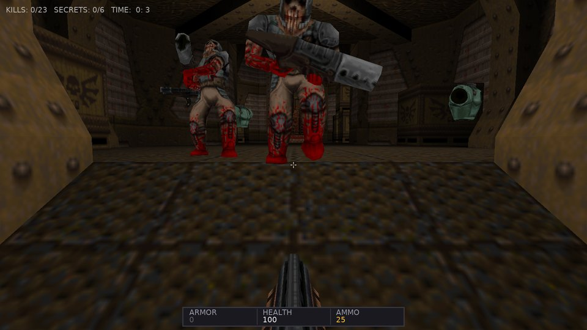 | 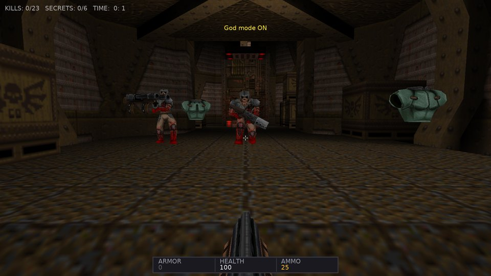 |
| Monsters with Quake's AI: sight, chase, attacks, pain and gibs | Infighting and sound propagation wake the rest |
| 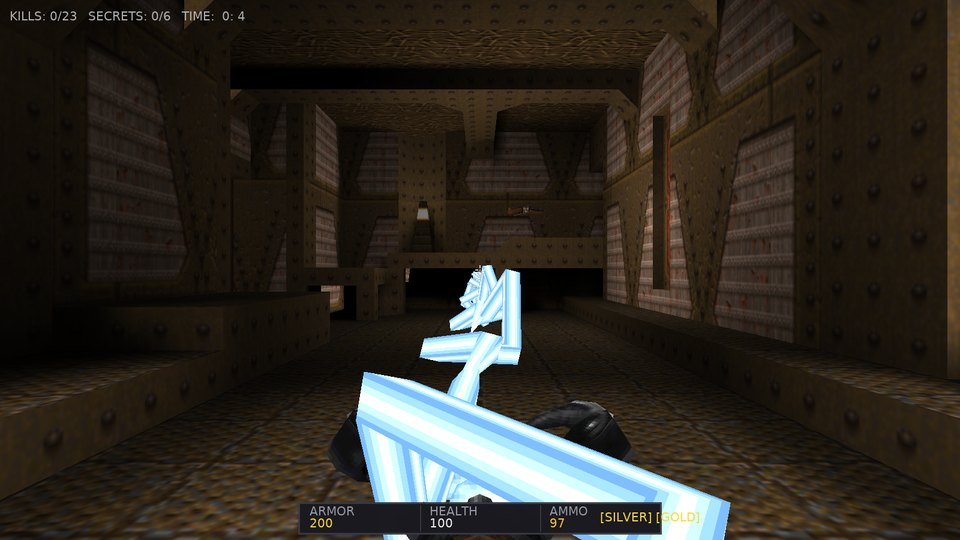 | 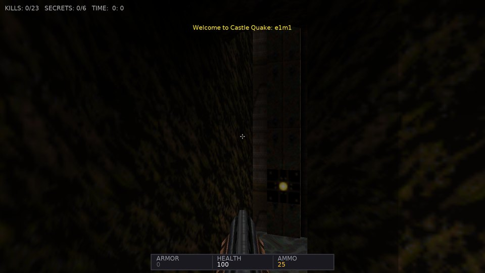 |
| All eight weapons, here the lightning gun beam | Water, slime and lava ripple like `R_Turbulent` |
| 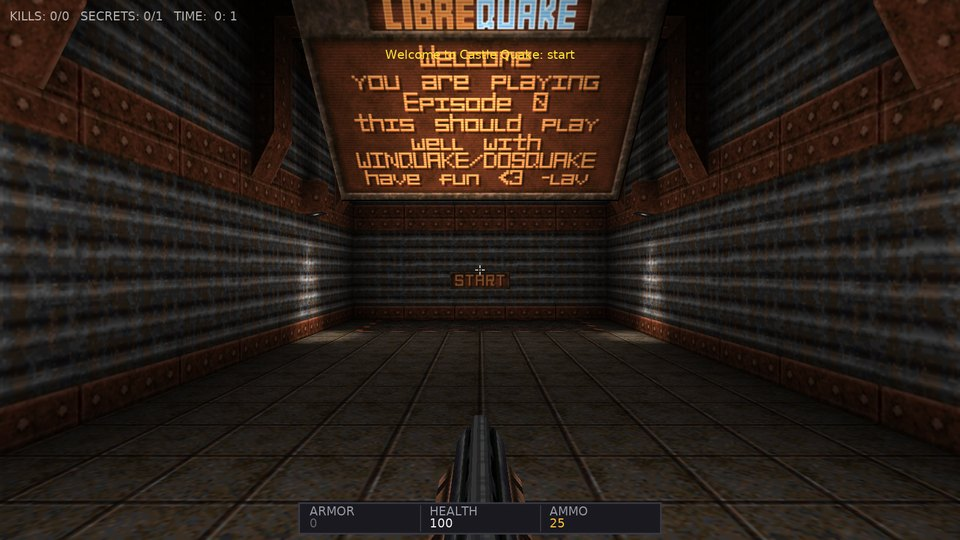 | 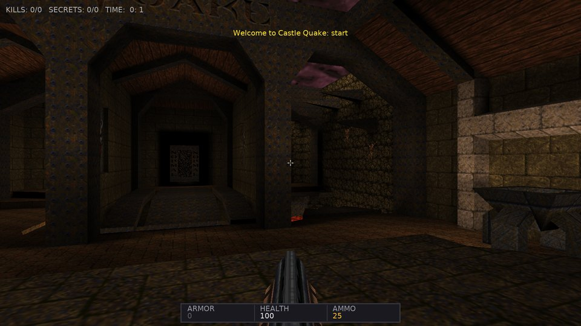 |
| The LibreQuake episode hub (bundled) | The original `start.bsp` hub with `-game quake` |
| 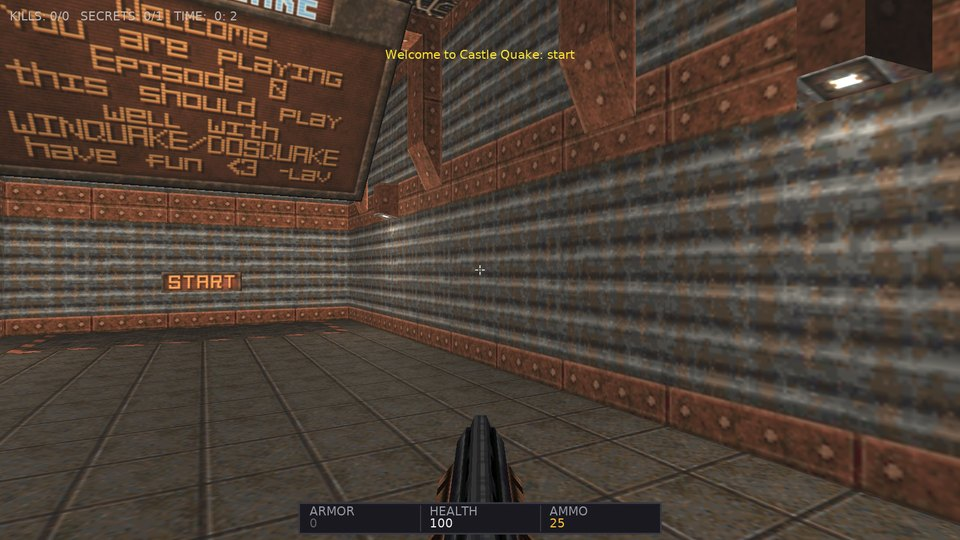 | 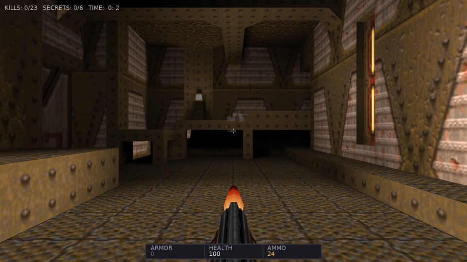 |
| "Dynamic PBR" world lighting with shadow maps, instead of the lightmaps | QuakeC mode: `progs.dat` runs the level |
| 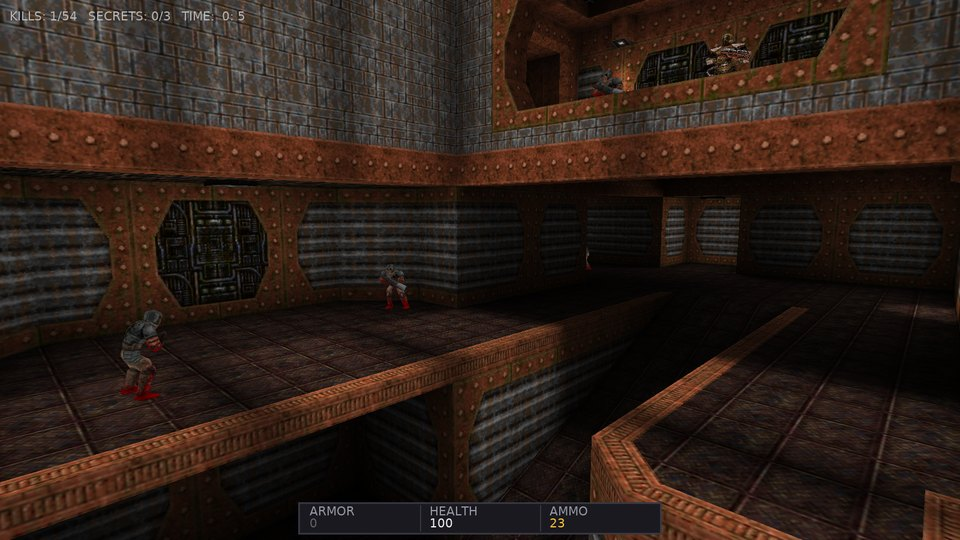 | 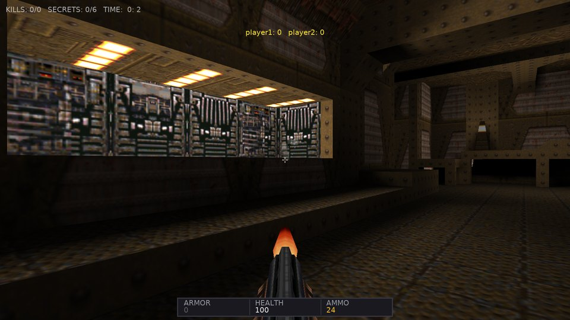 |
| The PAK demos play back (protocol 15) | Deathmatch over UDP with the scoreboard |
| 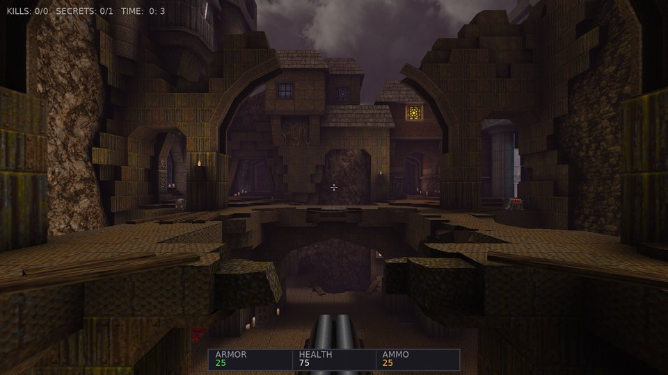 | 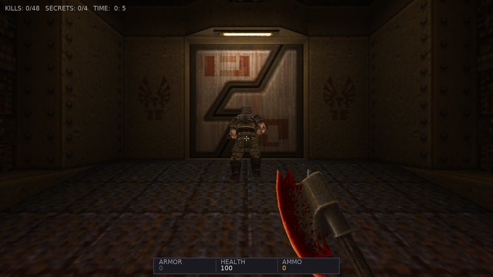 |
| Arcane Dimensions, made for QuakeSpasm, with its own QuakeC: fence textures (the vines) and thousands of entities | AD's first map with the fog and water alpha its QuakeC sets |
| 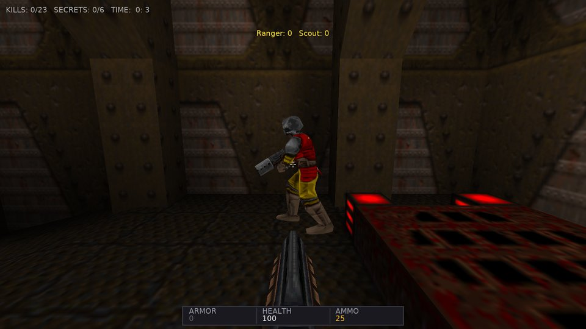 | 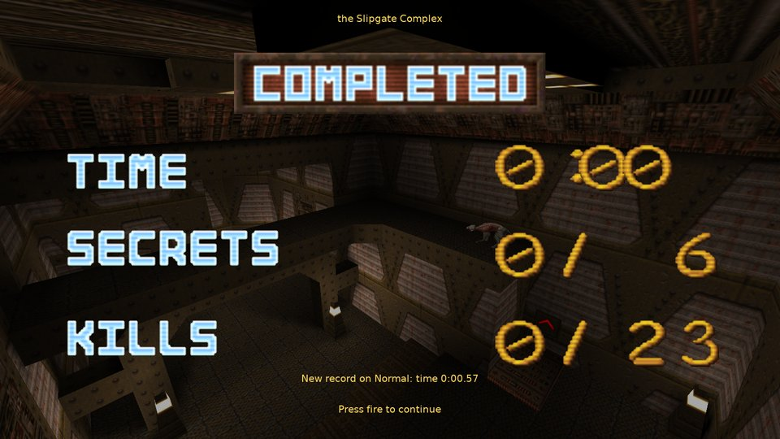 |
| Player names and shirt / pants colors in a network game | Map records: the intermission tells you about a new best |
| 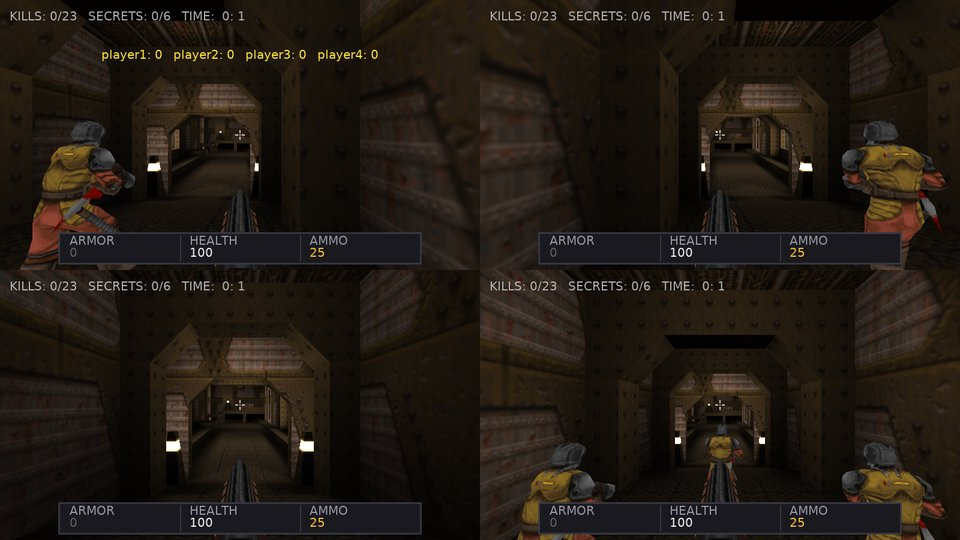 | 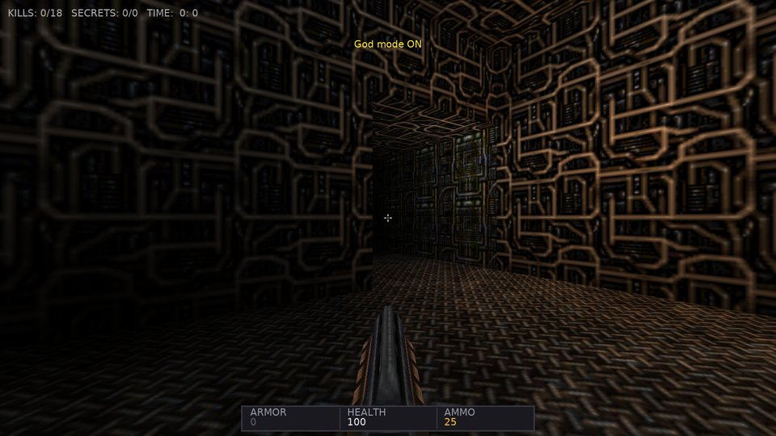 |
| Split-screen coop for up to four players | Random maps built from a seed |
| 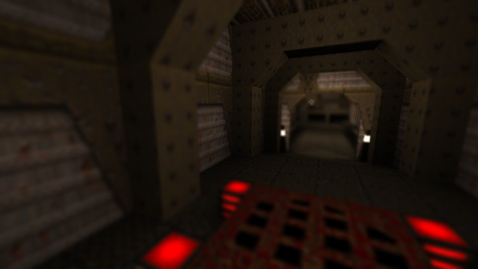 | 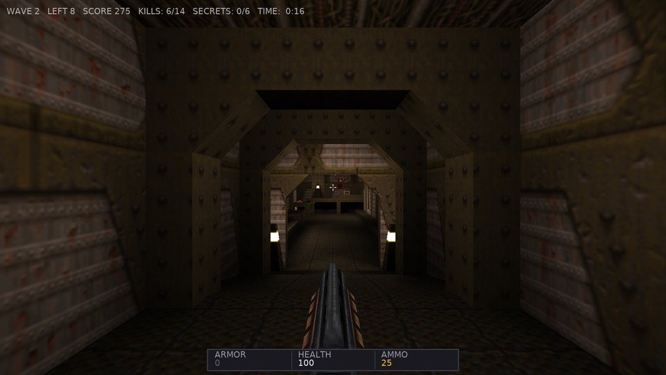 |
| Photo mode with depth of field | Horde mode: waves of monsters with a score |
