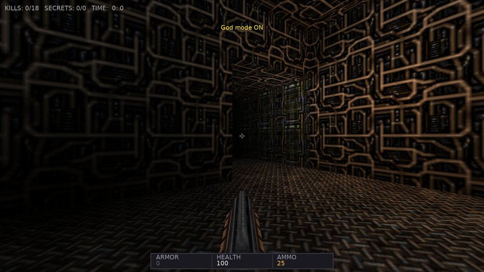
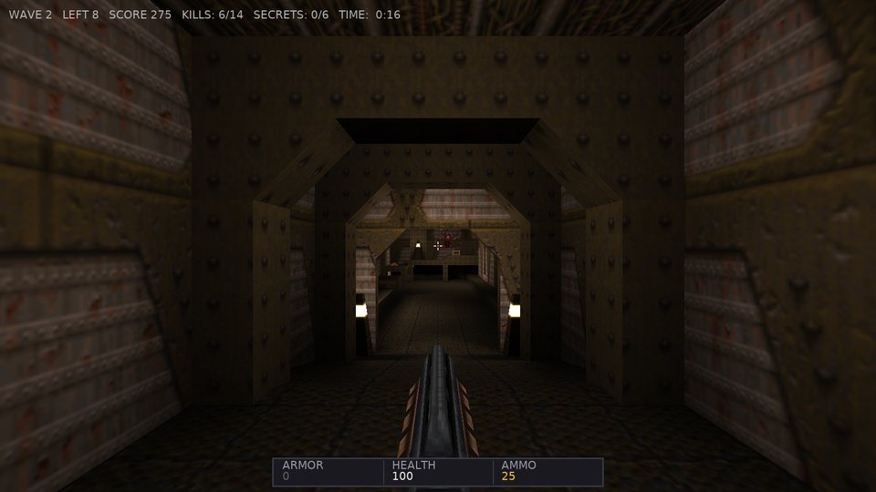
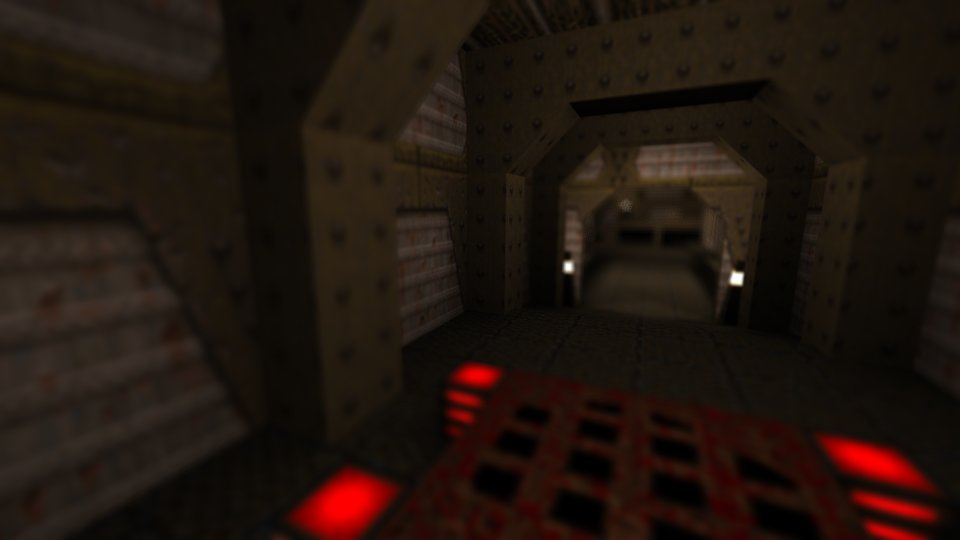
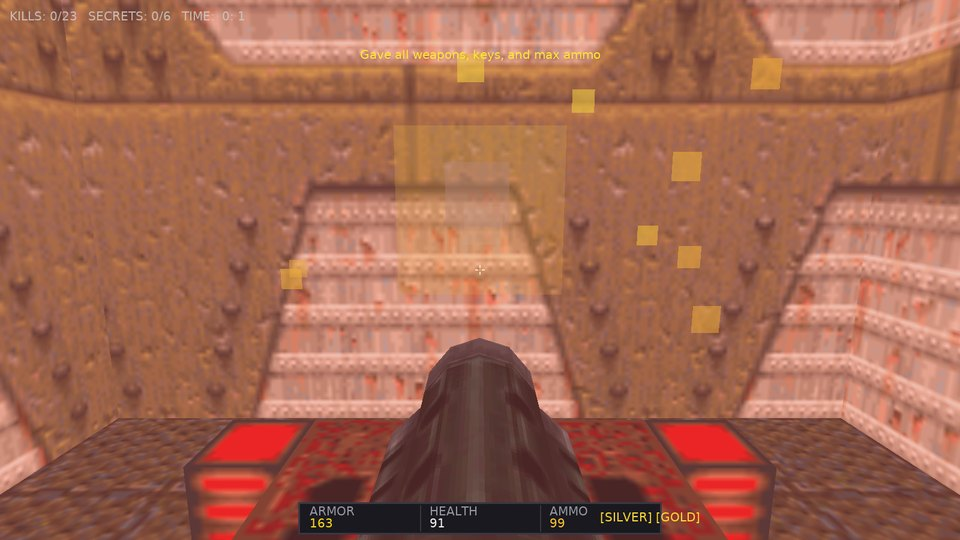
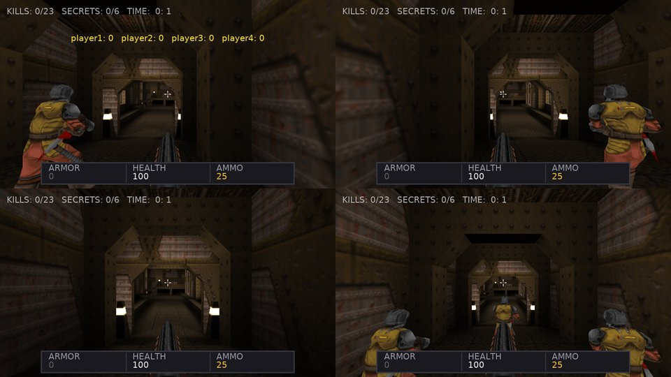
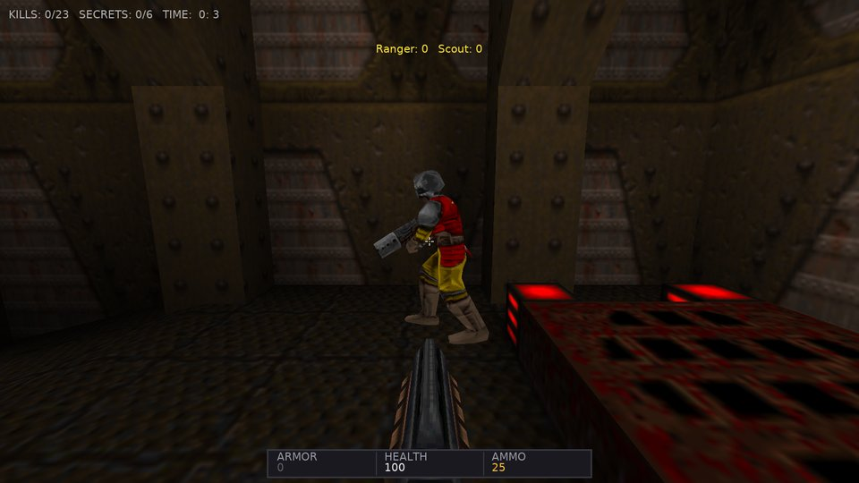
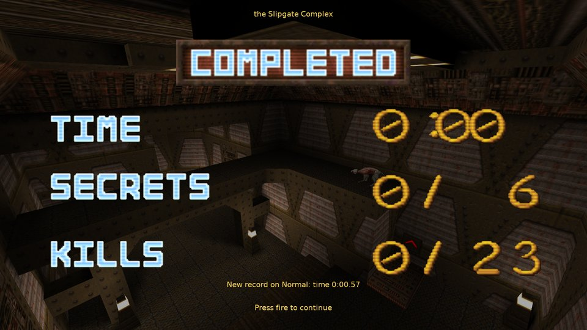
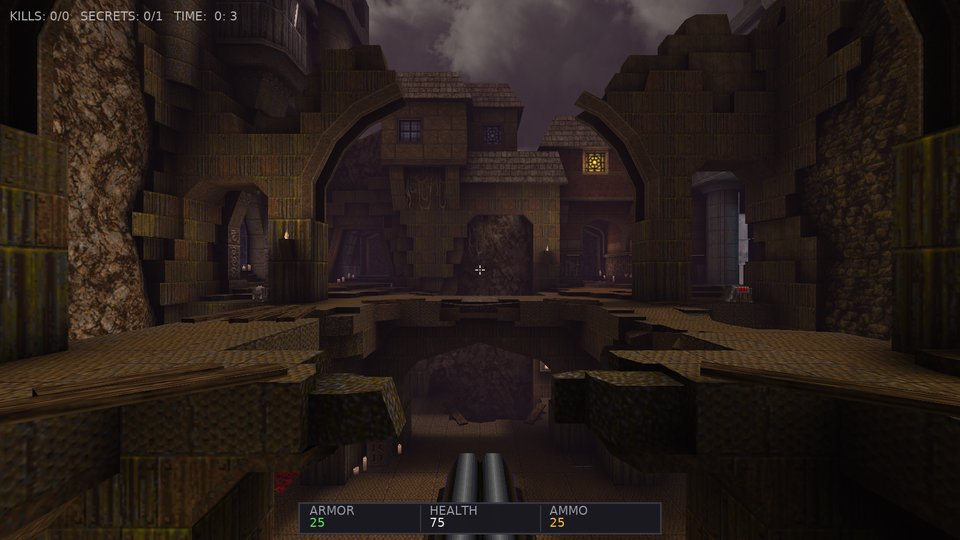
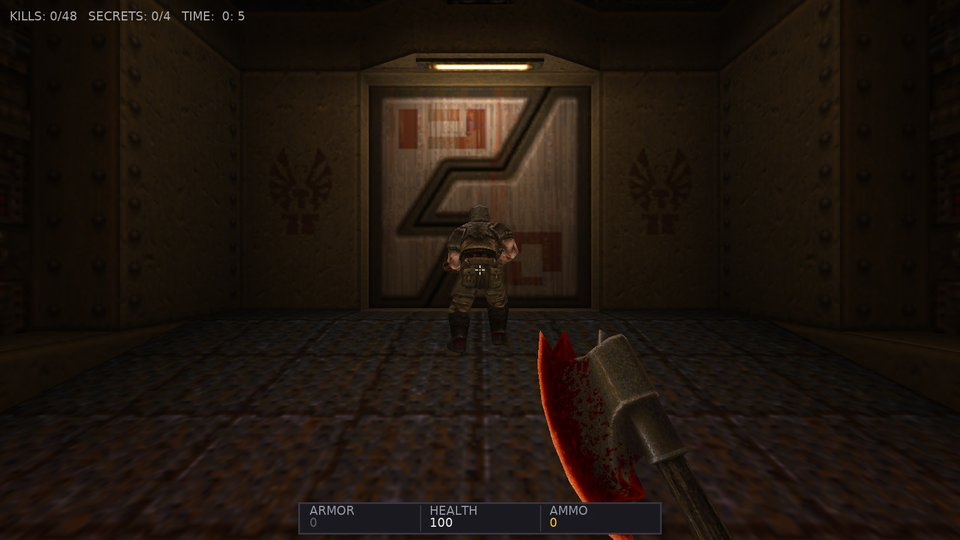

# Castle Quake Roadmap

This document outlines the architectural comparison between **Castle Quake** and the original **Quake 1** (id Tech 2 / GLQuake / WinQuake), identifying missing features and detailing the implementation milestones to achieve 100% authentic Quake look, feel, and gameplay powered by the **Castle Game Engine**.

Finished items are ticked here with a one-line description; how each was built and tested is in [HISTORY.md](HISTORY.md). Open items are at the end ([Phase 18](#phase-18-faster-better-looking-simpler)).

---

## 🎯 Architectural Comparison

| Subsystem | Original Quake 1 | Castle Quake (Current) | Target / Gap |
| :--- | :--- | :--- | :--- |
| **World Geometry** | BSP v29 tree, PVS clusters | Procedural X3D scene graphs (`TShapeNode`, `TIndexedTriangleSetNode`) | Full BSP geometry supported with texture coordinate mapping. |
| **Surface Lighting** | Static 8-bit luxel lightmaps in BSP + lightstyle animators | Default: the BSP lightmaps (all lightstyle layers) blended in a GLSL effect with the live lightstyle values and dynamic lights (`R_BuildLightMap` / `R_AddDynamicLights`). Option: physical materials under the engine's real-time point lights and shadow maps | Matches original; the dynamic PBR mode is the modern alternative. |
| **Dynamic Lights** | Lightstyles (0..63) modulated at 10 Hz; muzzle flashes | Quake lightstyles (0..12) evaluated dynamically; muzzle flashes; shadow maps | Matches original; enhanced with real-time shadow mapping. |
| **Sky & Atmosphere** | Double-layer scrolling cylindrical sky dome | Dual-layer scrolling sky shader (`Effect` node, GLQuake `EmitSkyPolys` projection per fragment) | Matches original. |
| **Liquid Surfaces** | Translucent water, lava, slime with sine wave turbulence (`R_Turbulent`) | Translucent liquid surfaces whose texture coordinates ripple in a GLSL effect (`R_Turbulent` / `EmitWaterPolys` turbsin warp), animated textures | Matches original. |
| **Screen Effects** | Palette shifts on damage (red), pickup (gold), water (blue), biosuit (green) | `V_CalcBlend` color shifts (damage, pickup, water/slime/lava, biosuit) and `D_WarpScreen`-style underwater warp | Matches original. |
| **3D Models** | Alias MDL v6 with discrete keyframes | Alias MDL v6 parser, per-state animation sequences with keyframe interpolation | Matches original (plus lerping, like later Quake engines). |
| **Audio** | 8-bit unsigned PCM mono WAVs, OpenAL 3D spatialization, CD music | PAK WAVs played through OpenAL (`TCastleSoundSource`), static ambient emitters and BSP leaf ambients, OGG background music | Matches original. |
| **Player Movement** | Custom Quake physics: air acceleration, strafe-jumping, bunny-hopping, water swimming | Port of the NetQuake player physics (`QuakePhysics`) tracing the BSP clipping hulls, doors and monster boxes | Matches original. |
| **Weapons & Combat** | 8 weapons: hitscan, spikes, bouncing grenades, rockets, lightning discharge | All 8 weapons from QuakeC `weapons.qc`: hull-traced hitscan, colliding nails, bouncing grenades, rockets with splash and knockback, lightning beam and discharge | Matches original. |
| **Monsters & AI** | 12 monster types + 2 bosses, state machine animations, infighting, sight tracing | All 13 monster types and both bosses with QuakeC data, `FindTarget` sight checks, `SV_movestep` chasing, frame-timed attacks, infighting, `sight_entity` alerts and PVS gunfire noise | Matches original (plus gunfire noise through open doorways). |
| **Gibs & Gore** | Overkill (> -40 health) explodes monsters into flying head/meat gibs | `ThrowGib` / `ThrowHead` with QuakeC thresholds, bouncing gib models and blood trails | Matches original. |
| **Level Flow** | `trigger_changelevel`, locked doors with Silver/Gold keys, secret counters | Start map hub with skill and episode portals, runes and episode gates, level parms carried between maps, trigger messages, secret areas, keys tracked in HUD, warp console command, submodel doors, silver and gold key doors (`door_touch`: the worldtype message and sound without the key, the key used up and the door staying open with it) | Matches original. |
| **Intermission** | Intermission stats screen with animated tallies and sound effects | `info_intermission` camera, level title, `gfx/complete.lmp` / `gfx/inter.lmp` and big number pictures with counting tallies, `trigger_secret` counting | Matches original (plus counting tallies). |
| **Save / Load** | Quake binary savegame format (`.sav`) | Text key/value savegames in the user config directory: level, player, inventory, doors and plats, items, monsters and triggers; F6 / F9 quicksave and console `save` / `load`; projectiles and gibs in flight are saved too | Matches original (text format instead of binary). |
| **Demos** | `.dem` recording and playback of the network stream (protocol 15) | `QuakeDemo`: protocol 15 reader with server frame interpolation shown by `GameViewDemo`, writer recording the game from `TQuakeWorld` (console `record` / `stop`) | Matches original; demos play in Quake engines too. |
| **Game Logic VM** | Stack-based QuakeC bytecode VM (`progs.dat`) | Native Object Pascal gameplay by default; "QuakeC Mode" runs the level with `progs.dat`: the interpreter (`QuakeProgs`) plus a world host (`QuakeQcGame`: hull traces, `sv_phys.c` movetypes, `sv_move.c` steps, the player with the Quake physics) and its own view | Matches original for mods' game logic; QuakeC mode saves and loads (the whole VM state) and records demos too. |

---

## 🗺️ Milestone Roadmap

### Phase 1: Authentic Look & Feel (Visual Polish)
- [x] **Dual-Layer Scrolling Sky Shader**:
  - Sky miptexes are split into a solid back layer and a transparent cloud front layer, projected onto Quake's flattened sky dome per fragment and scrolled at 8 / 16 texels per second.
- [x] **Underwater Screen Distortion & Palette Tints**:
  - Full-screen color shifts blended like `V_CalcBlend`: red on player damage (monster attacks now hurt the player, with armor absorption, death and level restart), gold on item pickup, green while the biosuit is active, and liquid tints when the eye is in water, slime or lava (BSP point contents).
  - GLSL screen effect reproducing the sine-wave underwater warp; liquid surfaces are no longer solid so the player can dive in.
- [x] **Model Keyframe Interpolation (Mesh Lerping)**:
  - `TMdlAnimator` plays QuakeC frame ranges at 10 Hz and interpolates vertex positions between keyframes every rendered frame; monsters use stand/run/attack/pain/death sequences and the view weapon plays its firing frames.
  - Distant (beyond 1024 units) and off-screen models skip the per-frame pose update to keep the cost low.
- [x] **Ambient Map Sound Emitters**:
  - Looping positional emitters for every entity QuakeC gives an `ambientsound()` (`ambient_*`, torches and flames, fluorescent lights), with Quake's linear `ATTN_STATIC` falloff; only the 8 loudest hold a sound source.
  - BSP leaf ambients: water and wind loops faded by the `ambient_level` of the listener's leaf (`S_UpdateAmbientSounds`).
  - Fixed the `quakepak:` protocol to report MIME types, without which no PAK sound could be decoded.

### Phase 2: Authentic Physics & Combat
- [x] **Quake Movement Physics**:
  - `SV_UserFriction` / `SV_Accelerate` / `SV_AirAccelerate` (30 u/s air wish speed: bunny-hopping and strafe-jumping), gravity 800, jump 270, stair stepping (`SV_WalkMove`) and plane sliding (`SV_FlyMove`) against the BSP clipping hulls (`SV_RecursiveHullCheck`), brush entities and monster boxes.
  - Swimming (`SV_WaterMove`: 0.7× speed, water friction, sink when idle, swim up with jump, look down to dive), water jumps out of pools, air supply with HUD meter, drowning, gasps and splash sounds.
  - Lava (10 × waterlevel every 0.2 s) and slime (4 × waterlevel per second) damage, reduced/blocked by the biosuit; falling damage and landing sounds.
  - Needed along the way: plats rest at the bottom and rise when stood on, doors open from their touch field, buttons fire their targets, triggers use their brush bounds and teleporters move the player.
- [x] **Complete Weapons Arsenal**:
  - Shots and projectiles trace the BSP hulls, brush entities and monster boxes (no more hitting the nearest monster through walls).
  - **Axe / Shotguns**: 64-unit melee trace; `FireBullets` with 6 pellets (spread 0.04) or 14 (0.14 x 0.08), 4 damage each, summed per target.
  - **Nailgun & Super Nailgun**: 10 nails per second at 1000 u/s from alternating barrels, 9 / 18 damage, ricochet sounds, blue-purple contrails.
  - **Grenade Launcher**: bouncing physics (1.5 overbounce, rests on floors), 2.5-second fuse, explodes on monsters, 120 radius damage.
  - **Rocket Launcher**: smoke trails, 100-120 direct damage plus `T_RadiusDamage` falloff, knockback (rocket jumping); missiles vanish into the sky.
  - **Lightning Gun (Thunderbolt)**: 600-unit beam drawn with `bolt2` segments, 30 damage per 0.1 s, underwater discharge that empties the cells and kills.
- [x] **Gib System**:
  - Overkill below each monster's QuakeC threshold (grunt and dog -35, knight -40, ogre -80) replaces the body with its head model and three meat gibs, thrown with `VelocityForDamage` (faster with more overkill), tumbling and bouncing on the BSP hulls, with blood trails, a blood fountain and `udeath.wav`. Gibs disappear after 10-20 seconds; heads stay.

### Phase 3: Monster Roster & AI Complete
- [x] **Full Monster Cast**:
  - **Fiend (Demon)**: long-range leaping jump attacks and slash combos.
  - **Scrag (Wizard)**: 3D flying movement and spit projectile attacks.
  - **Hell Knight**: multi-slash projectiles and charging melee.
  - **Shambler**: long-range instant lightning spell and devastating claw melee.
  - **Vore (Shalrath)**: tracking purple homing pods.
  - **Tarbaby (Spawn)**: high-speed bouncing and explosive death.
  - **Rotfish**: aquatic swimming and biting.
  - **Chthon** (E1M7 boss) and **Shub-Niggurath** (End boss).
  - Done with a data-driven `QuakeMonsters` unit: QuakeC sizes, health, frames and sounds for all classes (plus the existing grunt, dog, ogre, knight, and the enforcer and zombie); monsters wake on line of sight, chase with `SV_movestep` over the BSP hulls, attack on animation frames (traced grunt pellets replace the old hit chance), leap, flinch, die and gib. Zombies only die from gibbing and get knocked down by big hits; spawns explode; Chthon rises when the rune is taken and dies from three electrode shocks; Shub-Niggurath idles invulnerable (her telefrag ending is not done).
- [x] **Monster Infighting & Sound Propagation**:
  - Monsters retaliate against other monsters when damaged by friendly fire.
  - Weapon gunfire sound propagation alerting monsters across open doorways.
  - Done following QuakeC `T_Damage` / `ai.qc`: monsters track an `Enemy` (nil = the player) and turn on any other class that hurts them (grunts also fight grunts), with melee, pellets, missiles, lightning and leaps all hitting whatever is in the way; once that enemy dies they go back to the player. `FindTarget` now needs the player in front (`infront`) unless very close or the player just fired (`show_hostile`), a monster that has just spotted the player wakes the monsters that can see it (`sight_entity`), and gunfire wakes idle monsters within 1000 units whose leaf is in the player's PVS (the BSP visibility lump) and which no closed door cuts off. Ambush monsters (`spawnflags 1`) ignore both.

### Phase 4: Progression, UI, & Game Flow
- [x] **Episode Portals & Hub Flow**:
  - Walking into difficulty and episode portals in `start.bsp` transitions seamlessly into `e1m1`, `e2m1`, `e3m1`, or `e4m1`.
- [x] **Intermission Screen**:
  - Authentic intermission screen showing level title, animated tallies for kills, secrets, and time, accompanied by classic Quake tally sounds.
- [x] **Save & Load System**:
  - Savegame system recording player state, inventory, camera position, submodel states, and remaining monsters to disk or browser `localStorage`.
  - Done with `QuakeSaveGame` (`key=value` text saved through `castle-config:/save_<slot>.sav`, so CGE puts it in the user config directory) and `TQuakeWorld.SaveGame` / `LoadGame`: map, skill, runes and the hub choice, player stats and the level start parms, origin, velocity and view, air and timers, door / plat / button positions and states, taken items, monsters (position, yaw, health, state, alert, enemy, gibbed, counted) and fired triggers. Loading spawns the map again with the saved skill and puts every entity back by index. F6 / F9 quicksave and quickload like Quake, console `save [slot]` / `load [slot]`, demo actions `O:slot` / `L:slot`. Not while dead or in the intermission.
- [x] **Quake Demos (`.dem`)**:
  - Support recording and playback of original Quake demo files.
  - Done with the `QuakeDemo` unit: `TQuakeDemoReader` parses the NetQuake protocol 15 stream (serverinfo, baselines, static entities, fast entity updates with `cl_parse.c` interpolation between server frames, client data, sounds, temp entities, particles, lightstyles, prints, intermission) and `GameViewDemo` shows it: the demo's map with its brush entities placed by the recording, alias models at their frames, the view entity's eyes and recorded view angles, the view weapon, beams, trails from the model flags, sounds, the status bar and the intermission. "Demos" in the menu lists the PAK demos and recordings; `-playdemo <name>` and `--autotest <name>.dem` play one. `TQuakeDemoWriter` records the game from `TQuakeWorld` (console `record <name>` / `stop`, demo action `R:name` / `R`): the player, doors, monsters, items, projectiles and gibs each frame, client data, sounds, explosions, teleports, puffs, blood, centerprints, kills, secrets, damage and the intermission, one serverinfo section per level, with models and sounds numbered on first use and baselines written when the demo is saved to `castle-config:/<name>.dem`.

### Phase 5: Advanced & Modding Features
- [x] **Software Lightmap Rendering Option**:
  - Shader-based baked BSP lightmap blending for players who want 100% authentic WinQuake/GLQuake software-style shadowing alongside modern real-time dynamic PBR lighting.
- [x] **QuakeC (`progs.dat`) Bytecode Interpreter**:
  - Optional VM to run community QuakeC game mods directly inside Castle Quake.
  - Done. The VM: `QuakeProgs` loads `progs.dat` (version 6: statements, globals, fields, functions, strings), executes the whole instruction set like `pr_exec.c` (call stack, locals, `OP_STATE`, entity pointers), keeps the entity memory (`ED_Alloc` / `ED_Free`) and implements the builtins of `pr_cmds.c` (math, strings, `spawn`, `find`, `findradius`, `nextent`, precaches, prints, `changeyaw`, `vectoangles`, the `Write*` messages) with the world ones (`setmodel`, `traceline`, `walkmove`, `droptofloor`, sounds, lightstyles...) going through an overridable `TQuakeProgsHost`. `ED_LoadFromFile` spawns a map's entities through their QuakeC functions and `RunFrame` runs `StartFrame` and the due thinks. `--qctest <map>` runs this headless: on e1m1 the real progs spawn 336 entities, count 23 monsters and 6 secrets (the same as the native game) and run 2300 thinks in 10 s without errors. `QuakeQcGame` binds it to a level: `traceline` and the entity moves run over the BSP hulls (`SV_Move` with pushers, solid entities and the player), `walkmove` / `movetogoal` / `droptofloor` / `checkbottom` are `sv_move.c` ports, `sv_phys.c` runs every movetype (step monsters fall, toss / bounce / fly / missiles move and touch, pushers carry the player and call their thinks), the player is edict 1 moved by the Quake player physics between `PlayerPreThink` and `PlayerPostThink` (fire and impulses through `button0` / `impulse`, knockback and teleports read back), touches fire triggers and items, and the svc messages the progs write (damage, temp entities, intermission, setangle) become effects. `GameViewQc` renders it like the demo player (models at the progs' frames, brush entities at their origins, the view weapon from `weaponmodel`, the status bar from the player's fields). "QuakeC Mode" in Single Player, `-qc <map>`, `--autotest qc:<map>`. Verified on e1m1: the grunts' QuakeC kills the player, the super shotgun kills a grunt, death restarts the level, `changelevel` loads the next map with the level parms. A mod's `progs.dat` loaded with `-pak` runs the same way. Savegames in this mode keep the whole progs state (`TQuakeProgs.SaveState`: globals, edicts, engine strings, precaches, checked against the progs crc on load) with the level's statics and lightstyles (`qc_save_<slot>.sav`, F6 / F9, `O:` / `L:`), and demos are recorded from the edicts and the player's fields with the same `TQuakeDemoWriter` (`R:name` / `R`). Not available in this mode: the hub's `-game` switch.
- [x] **Savegames and Demo Recording in QuakeC Mode**:
- [x] **Projectiles and Gibs in Savegames**:
- [x] **Key Locked Doors**:
  - `func_door` with `DOOR_SILVER_KEY` / `DOOR_GOLD_KEY` in the native game.
  - Done like `doors.qc`: key doors get no trigger field, they open when the player runs into them (or uses them) holding the key, which is used up (`other.items - self.items`), play the worldtype's `noise4` (`meduse` / `runeuse` / `baseuse`) and stay open (`wait -1`); without the key the worldtype's message ("You need the silver key" / "runekey" / "keycard") and `noise3` play at most every 2 seconds. Verified on e1m2's gold door: locked without the key, opens after picking it up (the `K` cheat in the test).
- [x] **Turbulent Liquid Surfaces**:
  - Water, slime, lava and teleporter textures warp like `R_Turbulent` / GLQuake's `EmitWaterPolys`.
- [x] **Multiplayer / Deathmatch**:
  - Network multiplayer support over WebSockets / UDP.
  - Done, over UDP. `QuakeServer` hosts a deathmatch game: the level runs in `QuakeQcGame` with `deathmatch 1` (the real progs rules: respawns on fire, frags, DM items and spawn points), and every client is one of its player edicts with its own Quake player physics, input and triggers (`SetClientInput`, `ConnectClient` / `DisconnectClient`, `PlayerPreThink` / `PlayerPostThink` per player, the players collide with each other). What happens is streamed as NetQuake protocol 15 messages (`TQuakeNetMessage`): the signon (serverinfo with the precache lists, lightstyles, statics, stats, names and frags) reliably, then each frame the time, the client's `svc_clientdata` and every visible entity unreliably, with the frame's sounds, particles and the svc messages the progs wrote (temp entities, damage, intermission, setangle). `QuakeNet` is the transport (`TQuakeNetSocket` non-blocking UDP, `TQuakeNetServer` with a stop-and-wait reliable channel and timeouts, `TQuakeNetClient`). The client is the demo player: `TQuakeDemoReader` in network mode parses the same messages from the connection, and `TViewDemo` sends the mouse look, movement, fire, jump and impulses back as `TNetInput`, shows the scoreboard on frag changes and respawns by firing. The host plays through a local client of its own listen server. Menu "Multiplayer" (host start / e1m1, join localhost), `-host <map> [-port N]`, `-connect host[:port]`, headless `--autotest host:<map>` and `--autotest connect:<host>` with the demo actions. Verified with two headless processes on one machine: both players spawn, see each other's entities and the scoreboard, move, fire, and the client is told when the host quits. Coop too: `-coop` (and "Host Coop" in the menu) hosts with `coop 1`, `deathmatch 0` and `-skill N`: the monsters, items and level flow of single player shared by everyone, respawning on fire at the coop spawn points. Not done: WebSockets, NAT traversal, prediction (the client moves at the server's rate, which is fine on a LAN).

### Phase 6: Inspectable in Castle Game Engine
Everything is built in code today: no editor designs, almost no component has a `Name`, transforms are created without an owner, and nothing is a `TCastleBehavior`. The CGE editor cannot open the UI and the runtime inspector (F8 in debug builds) shows an anonymous tree of class names. These items make the running game something you can click through and tweak in the engine's own tools.
- [x] **Named Components and Owned Hierarchy**:
  - Give every map scene, submodel, monster, pickup, projectile, gib, light and sound source a `Name` (`door_7`, `monster_ogre_3`, `light_12`, `pickup_health_4`), owned by a per-level root transform, so the F8 inspector shows a real scene tree where a monster or a door can be selected and its transform watched live.
- [x] **Entities as Behaviors**:
  - Wrap `TQuakeMonster`, `TQuakeSubmodel`, `TQuakePickup` and the trigger volumes in `TCastleBehavior` subclasses attached to their transforms, with published properties (health, state, target name, wait, key needed, spawnflags). The inspector shows and edits them while playing; the editor can place them later.
- [x] **UI Designs in the Editor**:
  - Move the menu, HUD, console and intermission layouts into `.castle-user-interface` designs under `data/` loaded with `DesignUrl`, so fonts, colors and positions are edited in the CGE editor instead of hardcoded.
  - Done for the menu, the HUD and the console: `data/ui/menu.castle-user-interface` (backdrop, title, subtitle, the `ItemsGroup` vertical group the menu fills with one label per item, the showcase text, the hint), `data/ui/hud.castle-user-interface` (message banner, stats line, the status bar frame with the armor / health / ammo titles and values, dividers, keys, the air bar) and `data/ui/console.castle-user-interface` (the drop-down panel, border line, output and prompt labels). `TQuakeMenu`, `TQuakeHud` and `TQuakeConsole` load them with `UserInterfaceLoad`, find the components by name and only set captions, colors and visibility each frame; the designs open and edit in the CGE editor. Still drawn in code: the palette blends, the crosshair and the intermission screen (Quake's own pictures with counting tallies).
- [x] **Map Export to X3D / glTF**:
  - `--export-map e1m1 out.x3d`: the generated geometry with lightmaps, submodels, lights and entity markers, to open a level in the editor or `view3dscene` and inspect it offline.
- [x] **Debug Overlays and Console Commands**:
  - Wireframes of the clipping hulls and trigger boxes, monster paths and sight lines, the current PVS leaf, `edicts` listing in QuakeC mode, frame timing; toggled from the console and the demo script.
- [x] **Split `quakeworld.pas`**:
  - The native gameplay (3500 lines) into units per subsystem (player, weapons, monsters glue, movers and triggers, pickups, savegame, recording) so each piece can be read and unit-tested on its own.

### Phase 7: Beyond the Shareware
- [x] **Multiplayer Prediction and Connectivity**:
  - Client-side prediction of the local player's movement (the client runs the Quake physics on its own input and reconciles with the server's `svc_clientdata`), and NAT-friendly connections (hole punching or a WebSocket relay for the web build).
- [x] **Mission Packs and the `-game` Switch in QuakeC Mode**:
  - Run `hipnotic` and `rogue` (their `progs.dat`, extra entities, HUD pictures and items) and honour `-game` in QuakeC mode like the native hub does.
- [x] **Full Registered Content**:
  - All four episodes with the rune flow on every episode gate, the Shub-Niggurath ending and the end-of-game text, verified with the headless tests.
- [x] **Audio Polish**:
  - Music tracks per map from the entity `sounds` key, underwater low-pass filtering, and the CD-track handling of `svc_cdtrack`.
- [x] **Rendering Polish**:
  - Skybox support, lava and slime particle effects, water seen from inside (`r_wateralpha` style translucency both ways), and the fullbright texture pixels of Quake's palette.
- [x] **Automated Test Coverage in CI**:
  - Unit tests for the BSP tracer, the QuakeC VM (opcode tests and known `progs.dat` spawn counts), savegame round-trips and the demo writer / reader, run by the Build workflow so regressions are caught before a release.
- [x] **Input**:
  - Gamepad support and key rebinding through CGE's input system, saved in the user config.

### Phase 8: Reach and Robustness
- [x] **Multiplayer in the Browser**:
  - A WebSocket relay so the web build can join games: the browser has no UDP, so a small relay (in the executable, like the rendezvous service) forwards the same packets between WebSocket clients and the UDP server, and the WebAssembly build gets a WebSocket transport behind `TQuakeNetSocket`.
- [x] **Gamepad Testing and Tuning**:
  - Verify the controller paths on real Xbox, PlayStation and Switch pads (the CI container has none), and add options for stick sensitivity, dead zone and inverted look, saved in the user config next to the bindings.
- [ ] **Real Controller Verification**:
  - Play with real Xbox, PlayStation and Switch pads on Windows, Linux and macOS and check CGE's button mapping (`gbSouth` as A / Cross, the bumpers, the D-pad, the analog triggers) against the controls listed in the README; fix the mapping per controller type where it differs. Needs the hardware.
- [x] **Gameplay Scenarios in CI**:
  - Headless gameplay runs in the Build workflow (finish E1M1 along a scripted route, save and load in the middle of a fight, a host and a client playing a deathmatch round) with their screenshots compared against reference images within a tolerance, so rendering and gameplay regressions fail the build.
- [x] **Rendering Performance on Large Maps**:
  - Draw only the potentially visible set: group the world geometry by BSP leaf clusters and hide the shapes outside the PVS of the camera's leaf each frame (`TQuakeBsp.LeafVisible` already answers the question), with a frame time comparison on the biggest registered maps.

### Phase 9: Modern Maps and Polish
- [x] **Entity PVS Culling**:
  - Extend the world's PVS culling to everything else: hide monsters, items, brush entities (doors, plats, trains), gibs and missiles whose leaf is outside the camera's PVS (Quake's `R_MarkLeaves` with the entity leaf check), and skip the vertex animation of hidden MDL models. Today only the world model is culled, so a map full of monsters still draws and animates all of them; compare the frame times with `Z` on E1M3 and lq_e0m2.
- [x] **Lightmap Atlas Pages**:
  - The world lightmaps go into one 2048 x 2048 atlas; when a big map fills it, the remaining faces silently fall back to full brightness. Open another atlas page (and lightmap set) when one is full, and log the page count, so large community maps keep their lighting.
- [x] **BSP2 and Extended Limits**:
  - Load the `BSP2` and `2PSB` formats (32-bit node, leaf, face and marksurface indexes) that modern community maps use beyond the BSP29 limits, and the FitzQuake protocol 666 in demos and network play for their larger coordinates, model and sound counts.
- [x] **Colored Light and Fog**:
  - Read `.lit` files next to the maps (RGB lightmaps, the Quakespasm convention) into the lightmap atlases, and the worldspawn `fog` key (density and color) as engine fog, both common in maps made for modern Quake engines; the bundled maps stay unchanged without them.
- [x] **Video Options**:
  - Field of view, brightness (gamma), view bob and weapon visibility in the Options menu and as console commands (`fov`, `gamma`, `cl_bob`), saved in the user config next to the controls; the wide aspect ratio keeps the vertical FOV (Hor+).
- [x] **Web Build Persistence and Smoke Test**:
  - Keep savegames, bindings and options in the browser's storage between visits, and add a CI job that serves the web build, loads it in headless Chromium, starts E1M1 and checks a screenshot and the console log, so a broken WebAssembly build fails before a release.
- [x] **Touch Controls**:
  - On-screen sticks and buttons (move, look, fire, jump, use, weapon cycle) for touch screens, used by the web build on phones and an Android package built by the workflow (CGE supports both); the HUD layout leaves room for them.
  - Phone screens: the editor designs are made for 1600 x 900, and the engine's enclosing UI scale ignored the density, so a phone's canvas (2 to 3 device pixels per CSS pixel) showed the HUD and menu text at 5 to 10 CSS pixels and, held upright, the touch controls (scaled a second time by the window height) ran into each other. `GameScreen` sets an explicit UI scale on every resize: the larger of the enclosing scale and 0.7 times the density (the page's `devicePixelRatio`, Android's dpi / 160, a desktop's dpi / 96), capped so 800 x 480 design units stay on screen; a 1600 x 900 desktop keeps scale 1 (the reference screenshots are unchanged), a 2532 x 1170 phone gets 2.1 (1206 x 557 design units) instead of 1.3, a portrait one 1.46 (800 units across) instead of 0.73. The touch controls now fit those design units (narrower in portrait). In the browser the first touch also asks for fullscreen and a landscape lock (`?fullscreen=0` keeps the page as it is). `-density <x>` with `--geometry WxH` tries a phone's layout on a desktop; the `touch` scenario runs a 1170 x 2532 portrait phone at density 3 too, and a unit test checks the scale for desktops and phones.
- [x] **Android Package**:
  - Build an APK (and an AAB for stores) in the Build workflow and attach it to the releases. It needs FPC cross-compilers for arm / aarch64 Android and the SDK / NDK: CGE's Docker image has them, but the workflow stopped using it after Docker Hub's pull rate limit failed the runs, so the job either builds the cross-compilers on the runner (its Android SDK and NDK are preinstalled) or caches an authenticated image pull. The touch controls and the landscape orientation in the manifest are ready; check the data size (the paks) against the store limits.
- [x] **Performance Budgets in CI**:
  - The gameplay scenarios record the PVS counts (clusters and shapes drawn) at fixed camera spots and fail when they grow past a margin, and log the `Z` frame times as a workflow artifact; shape counts are deterministic where llvmpipe frame times are not, so culling regressions are caught without flaky timing checks.

### Phase 10: Community Content
- [x] **Server-Side PVS and Delta Updates**:
  - The network server sent every visible entity with all its fields each frame and stopped at 7000 bytes, so on big maps or in coop the entities past the cut-off vanished for the clients. Send only the entities in each client's potentially visible set (`SV_WriteEntitiesToClient`), as differences from baselines sent at signon (`SV_CreateBaseline`).
- [x] **Loose Files and .pk3 Mods**:
  - Load a `-game` directory the way mods ship: loose files (`<mod>/maps/x.bsp`), `pak0..9.pak` and `.pk3` (zip) archives, so a community map dropped into a mod folder plays.
- [x] **Large Coordinates (Protocol 999)**:
  - Protocol 666 still sends 16-bit coordinates, so a map reaching beyond +-4096 units wraps around in demos and network play. Read and write RMQ's protocol 999 (protocol flags for float or 24-bit coordinates and float angles) and pick it for maps whose bounds exceed the 16-bit range; a scenario with a converted map scaled beyond 4096 units checks positions survive a demo round trip and a network game.
- [x] **Fog and Skybox from Demos and Network Games**:
  - The demo reader already keeps `svc_fog` and `svc_skybox` (`FogDensity`, `FogColor`, `SkyboxName`); apply them in `TViewDemo` (the skybox through the existing skybox shader, fog with the engine's fog) together with the worldspawn `fog` key of the Colored Light and Fog item, and have the server and the demo writer send them for maps that set them.
- [x] **Community Map Regression Set**:
  - All BSP2 and 666 tests use converted E1M1. Add a CI job that fetches two or three freely licensed community maps (BSP2, a large BSP29, one with `.lit` and fog) into a cache, plays them headless with the `NC` and `Z` checks and a short QuakeC run, and fails on a load error, a culling difference or a frame time far off its recorded budget.
- [x] **Captions and Accessibility**:
  - Optional captions for the sounds that carry information (monsters waking and attacking off screen, doors, lifts, secrets, pickups), shown through the HUD message area with a direction hint, plus a high contrast HUD and a reduced flashes option for the damage and pickup palette shifts; all saved in the user config.

### Phase 11: New Ways to Play

| | |
| :---: | :---: |
|  |  |
| A random map from a seed | Horde mode's waves |
|  |  |
| Photo mode's depth of field | The play view the photo mode pauses |
- [x] **Random Map Generator**:
  - `-randommap [seed]` (and a Map Warp entry) builds a playable level in memory: a grid of rooms with corridors, stairs and height changes (a spanning tree of the room graph plus a few loops), doors between some rooms, a start and an exit (`trigger_changelevel` to the next seed), and monsters, items and secrets placed by distance from the start so difficulty rises along the critical path.
  - The level is written as a real BSP29 in memory (the `quakepak:` URL protocol serves it like a pak file), so the renderer, physics, PVS culling, QuakeC mode, demos and network games all use it unchanged: axis-aligned rooms make the BSP tree trivial (split planes along room walls, one convex leaf per room and corridor segment), the clipping hulls are the same boxes expanded by the player and monster sizes, the PVS is the room graph within a few steps, and the lightmaps are computed from placed lights with a simple per-texel visibility trace against the boxes. Textures come from the paks' wads by theme (base, medieval, metal), picked per region.
  - A seed fully determines the level (same seed, same map on every platform and in network games, where the host sends the seed instead of a file). Tests: a scenario walks from the start to the exit of a fixed seed along the room graph, the budgets and `NC` checks run on it, and a unit test checks the BSP's leaves, hulls and PVS against the room list.
- [x] **Horde Mode**:
  - Waves of monsters on any map (or a random one): monsters spawn at points out of the player's PVS, each wave stronger and mixing types, with a short pause, a wave counter in the HUD and a score table; coop over the network.
- [x] **Ghost Racing and Speedrun Timer**:
  - A level timer with splits per level and a best-time ghost: the best run's demo plays back as a translucent player model while you play, saved per map in the user config; the HUD shows the difference to the ghost at each split.
- [x] **Bots for Deathmatch**:
  - Simple deathmatch bots that read the map's items and the BSP for waypoints (item positions plus the floors between them, traced with the player hull), pick targets by distance and weapon, and play as network clients, so a lone player (or the browser) gets a match.
- [x] **In-Game Map Browser**:
  - A menu that lists Quaddicted's maps (title, rating, size, requirements), downloads one with its SHA-256 into the config directory and plays it, like the Quake Injector; installed maps can be removed again. Uses the same fetch and verify code as the community map tests.
- [x] **Photo Mode**:
  - Pause, free-fly the camera, hide the HUD and the view weapon, change the field of view, depth of field and screen effects (CGE's), and save a high resolution screenshot; also from demo playback.

### Phase 12: Comfort and Reach

Split-screen coop, here with four players (Phase 13's 2 x 2 grid).
- [x] **Save and Load Game Browser**:
  - Main Menu > Load Game lists the savegames with their map, health, kills, skill, level time and date, the newest first, with a thumbnail of the view when each was saved; Save Game (while playing) picks one of eight slots showing what each holds; `-load <slot>` starts from one.
- [x] **Controller Glyphs**:
  - Button prompts in the HUD hints, the menu and the photo mode's help line in the connected pad's own names (A / B / X / Y, Cross / Circle / Square / Triangle, the Nintendo layout with A and B swapped), picked from the controller's name, with an option to swap confirm and back; the software half of the real controller verification, testable with a named virtual pad.
- [x] **Map Browser Mods**:
  - Releases that need Quoth, Arcane Dimensions, Copper or another mod: install the mod from Quaddicted with them (the dependencies of `quaddicted-data`) and play them as a `-game` directory with QuakeC mode, since their progs replace the native gameplay.
- [x] **Split-Screen Coop**:
  - Two players on one machine: two viewports side by side or one above the other, the keyboard and mouse for one and a gamepad for the other (or two pads), playing the listen server's coop game as two local clients.
- [x] **Split-Screen Culling and the Web**:
  - Split-screen draws only what either player can see, each view projects the scrolling sky from its own eye, and the browser build hosts split-screen coop too.
- [x] **Localization**:
  - The menu, HUD, console help and captions from a translation file per language (picked from the system language, changed in Options), keeping Quake's own texts (level names, centerprints) as the maps and progs give them.

### Phase 13: Further Reach
- [x] **Bots in the Browser**:
  - Deathmatch against bots in the web build, on the page's own loopback listen server (Multiplayer > Deathmatch vs 3 bots, `?host=<map>&bots=3`), now that a page can host.
- [x] **Four-Player Split-Screen**:
  - Up to four local players: a 2 x 2 grid (three players: one wide view on top), each further gamepad joining as a player, the HUDs sized for a quarter of the window and the culling over every camera.
- [x] **Romanian and a Wider Font**:
  - A UI font with the glyphs CGE's default one lacks (ă, ș, ț and more of Latin Extended), embedded so it works in the browser and on Android too, and a Romanian translation.
- [x] **Mods Without the Memory Cost**:
  - Read an installed map's or mod's files from its zip on disk when they are asked for, instead of holding the whole zip in memory (Arcane Dimensions is 320 MB), and unmount a mod when a map of another one plays.

### Phase 14: Watching and Playing Together
- [x] **Demo Playback Controls**:
  - Pause, a speed from a quarter to four times, and seeking forward and back in a demo, with the position and the length shown.
- [x] **LAN Game Discovery**:
  - Hosts answer a broadcast on the local network, and Multiplayer > Find LAN Games lists them (map, players, deathmatch or coop) to join with one press.
- [x] **Spectators**:
  - Join a network game as a spectator that flies freely or follows a player (next / previous), without an entity in the game, and switch between the players' views.
- [x] **Bots in Coop**:
  - Bots that join a coop game, follow the players through the level, fight its monsters and press on when the players lead.

### Phase 15: Multiplayer Polish
- [x] **Recording Network Games**:
  - A client (or the host) records the network game it plays into a `.dem` that plays back like any demo, also when the recording starts in the middle of a level.
- [x] **Chat**:
  - `say` (and a chat key) sends a line to every player of a network game, shown in the HUD and the console like Quake's.
- [x] **Deathmatch Rules**:
  - `fraglimit` and `timelimit` end a deathmatch level with the scoreboard, and a map rotation picks the next level.
- [x] **Scoreboard**:
  - Tab shows every player's name, frags and ping in a network game (and the bots), sorted by frags; the intermission shows it too.

### Phase 16: Players and Teams

| | |
| :---: | :---: |
|  |  |
| Ranger in shirt 4, pants 12, seen by Scout | A new best time at the intermission |
- [x] **Player Names and Colors**:
  - Each player picks a name and shirt and pants colors (0..13, Quake's rows), sent when joining; everyone sees the others' names on the scoreboard and their player models in their colors.
- [x] **Teamplay**:
  - `-teamplay 1` and 2 (the progs' `teamplay` cvar): players on the same team (the pants color) do not hurt each other, the scoreboard groups the teams with their frags, and bots join the smaller team.
- [x] **Map Records**:
  - Each map keeps the best time, kills and secrets of the player's finished runs per skill, shown in the map list and the intermission (`New record`).
- [x] **Host Console**:
  - The listen server's host can kick a player or bot, change the map (`map <name>`) and the limits from the console during a network game, and the clients are told.

### Phase 17: QuakeSpasm Compatibility
The mods made for QuakeSpasm and QuakeSpasm-Spiked, Arcane Dimensions first, run with their own QuakeC and look as their authors meant.

| | |
| :---: | :---: |
|  |  |
| AD's hub: the vines are fence textures | `ad_e1m1` with AD's stuffed fog and water alpha |
- [x] **Mod Limits**:
  - The QuakeC VM holds QuakeSpasm's 8192 edicts (Arcane Dimensions' hub alone ran out of the vanilla 600 slots), and `ED_Alloc` searches only the edicts in use.
- [x] **Fence Textures**:
  - Textures whose name starts with a brace cut out palette index 255 (QuakeSpasm's alpha test), on the world and brush entities, with the lightmaps and in the dynamic lighting mode.
- [x] **Sprites**:
  - Sprites (`.spr`) are drawn in QuakeC mode, demos and network games: the original game's explosion, bubble and light and the many effect sprites of mods.
- [x] **Entity Alpha**:
  - FitzQuake's `alpha` field makes entities translucent in QuakeC mode, demos and network games.
- [x] **Mod Text and Commands**:
  - Prints in Quake's gold character set read as plain text, `maps/<name>.ent` replaces a map's entities, the worldspawn `wateralpha`, `slimealpha`, `lavaalpha` and `telealpha` keys set the liquids' opacity, stuffed commands run a whole line at a time, and a mod's own music plays.
- [x] **Smooth Models and Turning Brush Entities**:
  - Models blend from pose to pose (`r_lerpmodels`) in QuakeC mode, demos and network games, and brush entities turn with their angles.
- [x] **Arcane Dimensions Regression**:
  - The community map test plays Arcane Dimensions 1.81: its hub and first map with its QuakeC.
- [x] **Mod Sweep**:
  - Play the largest Arcane Dimensions maps and the Quoth and Alkaline mods with their own QuakeC and fix what breaks.
- [x] **Smooth Monster Steps**:
  - Walking monsters (`MOVETYPE_STEP`, moved once per think, 10 times a second) glide between their steps in QuakeC mode, like QuakeSpasm's `r_lerpmove`.
- [x] **QuakeC Extensions**:
  - The FTE / DP QuakeC extensions mods ask for with `checkextension`: the string, math, cvar, file and entity search builtins at their DP / FTE numbers.
- [x] **Point Particles**:
  - DarkPlaces' `effectinfo.txt` effects through `particleeffectnum`, `pointparticles` and `trailparticles` (DP_SV_POINTPARTICLES, FTE_SV_POINTPARTICLES), and particle rain and snow (DP_TE_PARTICLERAIN / SNOW), as QuakeSpasm-Spiked draws them.
- [x] **Mod Effects for Impacts and Trails**:
  - A mod's `effectinfo.txt` draws the standard temporary entities (TE_GUNSHOT, TE_SPIKE, TE_EXPLOSION, TE_TELEPORT...) and the model trails (TR_ROCKET, TR_GRENADE, TR_BLOOD...) it defines, as DarkPlaces does.
- [x] **Brush Entity Contents**:
  - FTE_ENT_SKIN_CONTENTS: a brush entity whose `skin` is a contents value (-3 water, -4 slime, -5 lava) is that liquid inside its brushes, for `pointcontents`, traces and the player's swimming, as in QuakeSpasm-Spiked and FTE.
- [x] **External Textures**:
  - `textures/<map>/<name>.tga` and `textures/<name>.tga` replace a map's textures (with `_glow` and `_luma`), like QuakeSpasm-Spiked.

### Phase 18: Faster, Better Looking, Simpler
Proposals from a pass over the code after Phase 17: what costs frame time on the largest mod maps, what the picture still lacks next to QuakeSpasm-Spiked and DarkPlaces, and where the code repeats itself.

**Performance**

- [x] **Area Grid for Entity Traces**:
  - Entity traces and the player's touches in QuakeC mode test only the entities near them (Quake's area nodes, here a grid) instead of every edict: about 40 instead of 4091 per trace on Arcane Dimensions' Sepulcher.
- [x] **Batched Engine Particles**:
  - The engine's own sparks, puffs, blood and explosions are one mesh of camera-facing quads instead of a scene with its own material per particle.
- [ ] **QuakeC VM Profile**:
  - A `profile` console command like Quake's (statements per QuakeC function over the last seconds) and a count of statements per frame in `Z`, to find what a heavy mod spends its time on; then the hot paths it shows (field lookups by name each frame in `TQuakeQcGame`, strings made per builtin call).
- [ ] **Frame Time Budgets for Mods**:
  - The `budgets` scenario watches culling counts on four maps and the community test three Quaddicted maps. Add frame times and entity counts at fixed spots of `ad_sepulcher` and `ad_tears` in QuakeC mode to the community test, so a slowdown on the largest maps fails a (non-gating) job.
- [ ] **Level Load Time**:
  - Log the time of each stage of a level load (BSP, lightmap atlas, textures, models, QuakeC spawn) and cut the largest: Sepulcher's 198 000 faces are the case to measure.

**Graphics**

- [ ] **Decals**:
  - Bullet marks, scorch marks and blood on the walls: `effectinfo.txt`'s `decal` sections (now skipped) and the engine's own impacts, as quads laid on the surface hit, fading out, with a limit on their number.
- [ ] **MD3 and IQM Models**:
  - The model formats newer mods ship besides `.mdl`: MD3 (vertex animation, tags) and IQM (skeletal), loaded into the same visuals as Alias models.
- [x] **Mod Effects in Demos and Network Games**:
  - A mod's `effectinfo.txt` effects for the temp entities and model trails are drawn in demos and network games too, not only in QuakeC mode.
- [ ] **Point Particles for Clients**:
  - Send the progs' `pointparticles` and `trailparticles` to network clients and into demos (`svc_pointparticles`); now only the host's own view shows them.
- [ ] **Particle Lights, Bounce and Stretch**:
  - The `effectinfo.txt` keys parsed but not used: `lightradius` / `lightcolor` (a dynamic light per effect), `bounce` (particles stop or bounce on the world), `stretchfactor` (sparks drawn along their velocity) and `rotate`.
- [x] **Smooth Movement in Demos and Network Games**:
  - Walking monsters glide between their 10 Hz steps in demos and network games too (`r_lerpmove`), from the protocol's step flag.
- [ ] **Anti-Aliasing and Texture Filtering Options**:
  - Options > Video for multisampling (off, 2x, 4x), anisotropic filtering (now fixed at 4) and the choice between Quake's blocky texels and filtered ones (`gl_texturemode`), saved with the other video settings.
- [ ] **Underwater View**:
  - The screen warps and tints under water in the original; here only the sound is filtered. A full-screen warp effect while the eyes are in a liquid, off with `reduced_flashes`.
- [ ] **Dynamic Light on Models**:
  - Rockets, explosions and muzzle flashes light the world's lightmaps; check and, where missing, light the monsters and items near them the same way, and let entities take the colored light of `.lit` files under them.

**Code simplification**

- [x] **One Entity Renderer for the QuakeC and Demo Views**:
  - The QuakeC view and the demo / network view draw their entities, temp entities and beams through one unit instead of two copies of the same nine methods.
- [ ] **Console Command Table**:
  - `gameviewplay.pas` runs commands through a chain of forty `if Cmd = ...` blocks and prints its help from a separate list; the QuakeC and network views have smaller copies. A table of commands (name, help text, handler, the views it works in) gives one dispatcher, a help text that cannot go stale and `CMD:` in every view.
- [ ] **Command Line Table**:
  - `gameinitialize.pas` parses over forty `-option` checks by hand, and the web build's `?option=` parameters repeat them. One table of options (name, argument, target variable) for both.
- [ ] **Split the Largest Units**:
  - `gameviewdemo.pas` (2900 lines: demo playback, network client, split-screen, spectator, chat, scoreboard) and `quakegeometry.pas` (2500) into include files per subsystem, the way `TQuakeWorld` is split in `code/world/`.
- [ ] **Stable Network Scenarios**:
  - Two releases (0.3.62 and 0.3.64) were held up by scenarios that depend on timing or a random deathmatch spawn (`dmrules`, `netrecord`). Give the network scenarios a fixed spawn spot for tests (`-spawnspot N`), wait for a log line instead of a number of seconds where they can, and let the runner repeat a failed network scenario once and say so.
- [ ] **Shared Test Helpers**:
  - `tests/scenarios.py` (1600 lines) and `tests/community_maps.py` each have their own process runner, log checks and pak writer; move them to one module and split the scenario checks by area.
